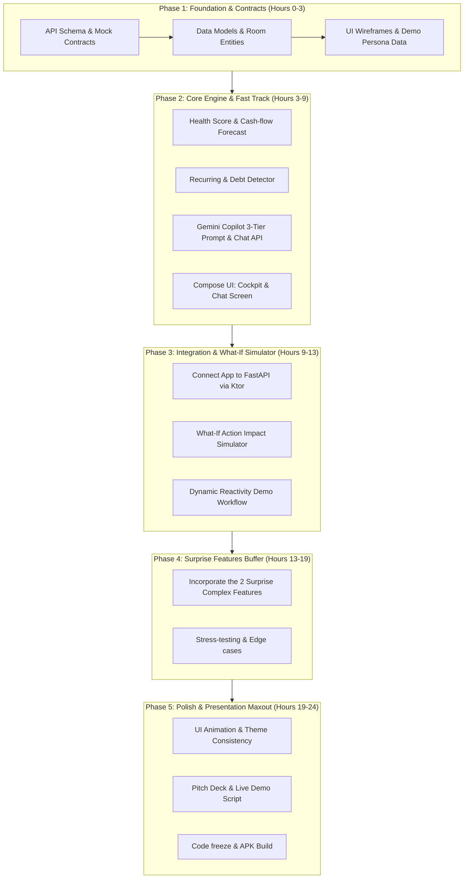

# RupAI — AI Financial Health Copilot: Hackathon Strategy & Implementation Plan

> **24-Hour Hackathon Blueprint**  
> **Target:** 100% Problem Statement Coverage + Evaluation Criteria Maxout (Round 2) + Ready buffer for the 2 surprise hard features.

---

## Part 1: Comprehensive Gap Analysis & PS Alignment

### 1.1 Problem Statement Breakdown vs. RupAI Capabilities

| # | Hackathon PS Requirement | Existing RupAI State (`RupAi.md`) | Gap Status | Required Implementation Delta |
|---|---|---|---|---|
| **1** | **Consolidated Financial-Health View** (Income, expenses, recurring payments, debt obligations, savings, cash-flow patterns) | Has Income, Expenses, Savings Rate, Categories from Bank SMS alerts. | ⚠️ **Partial Gap** | Lacks explicit **Debt Obligations/EMIs tracking**, **Unified Financial Health Score (0-100)**, and dedicated **Cash-Flow runway view**. Needs debt/loan detection & account aggregation logic. |
| **2** | **Recurring Obligations & Debt Pressure Detection** | Mentions recurring detection on roadmap (`todo.txt`), but not implemented in core logic. | ❌ **High Gap** | Build automated recurring payment/subscription/EMI detector (e.g. rent, Netflix, loan EMI, SIPs) from transaction history & predict next debit date. |
| **3** | **Future Cash-Flow Gaps & Predictive Runway** | Only calculates current month remaining balance (`income - expense`). | ❌ **High Gap** | Build a **30/60/90-Day Predictive Cash-Flow Forecast engine** with alerts on projected negative balances (cash crunch warnings). |
| **4** | **Conversational Copilot (Natural-Language Q&A)** (Spending, savings, debt, cash-flow pressure, affordability) | Has static AI Insights card (`GeminiAdvisor`) generating one-off advisory cards. | ❌ **High Gap** | Build a **Real-Time Interactive Chat Copilot Interface** (Chat UI + Tool-Calling/RAG over user's financial database) answering questions like *"Can I afford a ₹15,000 trip next month?"* or *"When will my next EMI hit?"*. |
| **5** | **Simulate Expected Impact of Recommended Actions** ("What-if" simulations, not just static status) | Currently only gives descriptive text advice (`SAVINGS`, `WARNING`, `ADVICE`). | ❌ **Critical Gap** | Build **Action Impact Simulator** (e.g., *"If you cut dining out by ₹3,000/mo, your emergency runway increases by 1.8 months and credit card debt cleared 2 months earlier"* with interactive slider / impact preview). |
| **6** | **Three-Tier Response Transparency** (Observed Facts vs. Model Predictions vs. Recommendations + Confidence Score) | AI advice is a combined text blob. | ❌ **Critical Gap (Key PS Requirement!)** | Strictly enforce response schema across all AI outputs & Copilot chat: <br>1. **[FACT] Observed Data** (100% verified)<br>2. **[PREDICTION] Model Forecasts** (with Confidence %)<br>3. **[ACTION] Actionable Recommendations** with simulated impact. |
| **7** | **Real-Time Dynamic Reactivity** (Recommendations adapt dynamically when new transaction/debt/income is added) | Has SMS BroadcastReceiver and batch sync, but insights are not auto-recalculated on the fly. | ⚠️ **Partial Gap** | Wire reactive Room Flow / LiveData trigger so adding a mock transaction or receiving SMS immediately recalculates Health Score, runway, and copilot context. |

---

### 1.2 Evaluation Criteria Alignment Matrix (Round 02)

| Criteria | Hackathon Weightage & Focus | Strategic Strategy to Score Maximum Points |
|---|---|---|
| **1. Innovativeness** | Originality & creative depth | • **Interactive "What-If" Impact Sandbox**: Drag a slider or toggle recommendations to see real-time financial health transformation.<br>• **Explainable 3-Tier AI Transparency**: First copilot in the hackathon with explicit separation of verified facts vs ML projections vs advice with confidence gauges. |
| **2. Tech Stack** | Modern tools & architecture | • **Android Compose Material3** + **FastAPI (Python)** + **Room DB & Supabase** + **Gemini 2.0 Flash / 1.5 Pro Function Calling**.<br>• Clean MVVM + Repository pattern with reactive Coroutine Flows. |
| **3. Presentation** | Clarity, delivery, story | • Crisp demo script: "Problem: Fragmentation -> Real-time SMS ingestion -> Unified Health Score -> Copilot Live Q&A -> Action Simulation -> Instant re-computation when a new ₹5,000 expense is injected". |
| **4. UI/UX** | Seamless, intuitive, visual polish | • Bronze/Brutalist or polished Modern FinTech Theme (Cred/Jupiter-level aesthetic).<br>• Dedicated **Copilot Chat Screen**, **Financial Health Cockpit** with animated gauge, **Interactive What-If Simulation Cards**. |
| **5. AI & ML Integration** | Depth and quality of AI | • Hybrid multi-layer categorization (VPA + Regex + Gemini).<br>• **Deterministic Cash-Flow Forecasting Model** (SARIMA / Exponential smoothing or robust rule-based projection).<br>• **Gemini Copilot with Structured Tools / JSON Schema** for structured outputs and impact projections. |

---

## Part 2: High-Velocity Architecture & Fast-Track Strategy

To complete the core requirements in **~8 to 10 hours** and leave a large buffer for the **2 surprise complex features**:
1. **Decouple Frontend & Backend cleanly via OpenAPI/FastAPI contracts**:
   - The Frontend specialist can work against mock JSON endpoints or direct UI state while the Backend builds the real calculations.
2. **Hybrid Engine (FastAPI Microservice)**:
   - Handle complex logic (Cash-flow time series prediction, RAG Copilot, What-If simulation) on the Python FastAPI backend where rapid development is 10x faster than writing everything in Kotlin on device. The Android app connects to it cleanly via Ktor.
3. **Pre-built Mock Data Generator**:
   - Judges won't have 6 months of historical Indian bank SMS on their test device! Include a **"Load Demo Persona"** button (e.g., "Software Engineer with 2 EMIs & High Discretionary Spending") to showcase rich graphs instantly.

---

## Part 3: 4-Member Parallel Team Division

```
┌─────────────────────────────────────────────────────────────────────────────────┐
│                           TEAM OF 4 PARALLEL WORKSTREAMS                       │
├───────────────────┬───────────────────┬───────────────────┬─────────────────────┤
│ MEMBER 1 (UI/UX)  │ MEMBER 2 (Android │ MEMBER 3 (Backend │ MEMBER 4 (AI/ML &   │
│ Jetpack Compose & │ Client Engine)    │ Engine - FastAPI) │ Financial Models)   │
│ Visual Polish     │ Architecture & DB │ APIs & Integrations│ Copilot & Simulator │
├───────────────────┼───────────────────┼───────────────────┼─────────────────────┤
│ • Copilot Chat UI │ • Room DB Entities│ • FastAPI REST API│ • Gemini Copilot    │
│ • Health Cockpit  │   (Debts/Runway)  │ • Endpoints for   │   Prompt & Tools    │
│ • What-If Sandbox │ • Dynamic updates │   Health/Forecast │ • 3-Tier Separation │
│ • Demo Switcher   │ • Ktor integration│ • Supabase Sync   │ • Impact Simulator  │
└───────────────────┴───────────────────┴───────────────────┴─────────────────────┘
```

### Member 1: Frontend & UI/UX Specialist (Dedicated Android Compose)
- **Role:** Screens, widgets, animations, and user experience.
- **Key Deliverables:**
  1. **Financial Health Cockpit Screen** (`HealthScoreCard`, Debt Pressure Gauge, Runway Indicator).
  2. **Copilot Chat Screen** (Chat bubbles with structured cards displaying Facts, Predictions, and Action buttons).
  3. **"What-If" Simulation Dialog / Screen** (Sliders for reducing expenses or prepaying debt, showing real-time impact delta).
  4. **Mock Data Injector UI** (Floating action pill: "Demo Persona: Salary Received / EMI Overdue / High Spend").

### Member 2: Android Core Engineer (Data, Room, Networking & State)
- **Role:** App state management, local database, reactive updates, API bridge.
- **Key Deliverables:**
  1. Extend Room DB with `DebtEntity` and `RecurringExpenseEntity`.
  2. Implement `CopilotRepository` and `HealthScoreRepository` communicating with FastAPI.
  3. Reactive Trigger Pipeline: Whenever SMS is parsed or a manual transaction is added, push update to `TransactionViewModel` which re-fetches or recalculates health state instantly.
  4. Build the offline demo seeder (generating realistic transactions, EMIs, and subscriptions).

### Member 3: Backend & Systems Engineer (FastAPI & Data Pipelines)
- **Role:** Python FastAPI backend services, schemas, and orchestration.
- **Key Deliverables:**
  1. **Financial Health Engine Endpoint (`/api/v1/health-score`)**: Calculates 0-100 score based on 5 pillars (Savings Rate, Debt-to-Income, Emergency Runway, Expense Volatility, Cash-flow stability).
  2. **Recurring & Debt Detector (`/api/v1/recurring-detect`)**: Clusters transactions by merchant and frequency (30±3 days) to isolate Netflix, Rent, HDFC Home Loan, Car EMI.
  3. **Cash-Flow Forecasting Engine (`/api/v1/forecast`)**: Generates 30-day ahead daily projected balance accounting for upcoming salary, recurring bills, and average daily spend.
  4. Dockerize / deploy to local network or Railway/Render/ngrok so Android app can communicate smoothly.

### Member 4: AI/ML & Financial Modeling Specialist (Gemini Copilot & Impact Engine)
- **Role:** LLM architecture, prompt engineering, structured output enforcement, and impact simulations.
- **Key Deliverables:**
  1. **Copilot RAG & Function Calling Engine (`/api/v1/copilot/chat`)**:
     - System prompt enforcing the **Strict 3-Tier Output**:
       - `facts`: Direct verified numbers from transactions.
       - `predictions`: Model forecast + `confidence_score` (e.g. 85%).
       - `recommendations`: Action steps with projected financial payoff.
  2. **Action Impact Simulator Engine (`/api/v1/simulate-action`)**:
     - Evaluates user questions like *"Can I afford an iPhone for ₹80,000?"* or *"What if I cancel 3 subscriptions?"*.
     - Returns before vs. after metrics (Runway: 2.1 mo -> 3.4 mo, Debt free date: Oct 2026 -> Aug 2026).
  3. Prepare rapid-response playground to tackle the **2 surprise complex features**.

---

## Part 4: Phase-Wise Implementation Roadmap (24-Hour Timeline)



### Phase 1: Contracts & Groundwork (Hours 0 – 3)
*Goal: Remove all blockers so everyone works in parallel without waiting on each other.*
- **All Team:** Lock down JSON response schemas (FastAPI Pydantic models).
- **M1 (UI):** Set up `CopilotChatScreen`, `HealthScoreScreen`, and navigation routes in Compose.
- **M2 (Android):** Add `DebtEntity` & `RecurringObligation` to Room DB; create `DemoDataProvider.kt`.
- **M3 (Backend):** Scaffold FastAPI endpoints returning static realistic mock JSON matching the schemas.
- **M4 (AI):** Design Gemini 2.0/1.5 system prompts with strict JSON schema enforcing 3-Tier transparency.

### Phase 2: Core Feature Implementation (Hours 3 – 9)
*Goal: Complete 80% of Problem Statement requirements.*
- **M1 (UI):** Build Chat UI with speech/text input, message bubbles supporting 3-Tier tags ([FACT], [PREDICTION], [ACTION]). Build Health Score speedometer gauge.
- **M2 (Android):** Hook up Ktor client to talk to FastAPI proxy; wire LiveFlow updates from Room to UI.
- **M3 (Backend):** Implement financial health algorithm + cash-flow forecast + recurring detector using Python logic.
- **M4 (AI):** Implement Gemini Copilot chat pipeline with context injection (user's monthly income, active debts, 30-day forecast).

### Phase 3: Integration, What-If Simulation & Dynamic Testing (Hours 9 – 13)
*Goal: Deliver full Problem Statement criteria.*
- **M1 & M2:** Bind live backend responses to Jetpack Compose UI.
- **M3 & M4:** Deploy `SimulateAction` endpoint (evaluating affordability & savings impact).
- **Team Milestone:** Complete end-to-end user loop:
  1. Open app -> View Health Score & upcoming EMI dates.
  2. Ask Copilot: *"Can I buy a PS5 for ₹45,000 this month?"*
  3. Copilot answers with Fact (current balance), Prediction (cash-flow dip), Recommendation + Impact.
  4. Click "Inject ₹10,000 surprise bill" -> Health score & runway recalculates dynamically.

### Phase 4: The 2 Surprise Complex Features Buffer (Hours 13 – 19)
*Goal: Conquer the organizer's surprise challenge without derailing existing work.*
- Dedicated 6-hour window reserved specifically for the announced surprise features.
- Since the base architecture is decoupled (Compose UI + FastAPI + Gemini Engine), new complex logic can be plugged into Python or Android in hours without breaking existing views.

### Phase 5: UI Polish, Pitch Deck & Demo Hardening (Hours 19 – 24)
*Goal: Maximize Round 2 Evaluation scores (Presentation, UI/UX, Innovativeness).*
- **M1 & M2:** Polish animations, dark mode, loading skeletons, haptic feedback, and error handling.
- **M3 & M4:** Ensure zero-latency failover (fallback to cached responses if AI rate limit strikes).
- **All Team:** Prepare 3-minute pitch deck, killer 2-minute live demo run-through, and architectural slide.

---

## Part 5: Response Schema Blueprint (PS Requirement 5 & 6)

Every output from the AI Copilot must follow this schema to satisfy the judges' requirement for **Facts vs. Predictions vs. Recommendations**:

```json
{
  "query": "Can I afford a weekend trip to Goa costing ₹20,000 next weekend?",
  "health_score_current": 72,
  "observed_facts": [
    "Your current bank balance is ₹38,400.",
    "You have an upcoming HDFC Home Loan EMI of ₹18,500 due on 15th.",
    "Your average discretionary spending over the last 14 days is ₹620/day."
  ],
  "model_predictions": [
    {
      "statement": "If ₹20,000 is spent, your projected balance on 16th will drop to -₹3,200 (Overdraft Risk).",
      "confidence": 0.92,
      "risk_level": "HIGH"
    }
  ],
  "recommendations": [
    {
      "action": "Postpone the trip by 2 weeks until your salary of ₹75,000 credits on the 30th.",
      "impact": "Avoids ₹850 overdraft fee and maintains your 2.4-month emergency cushion."
    },
    {
      "action": "Cap the trip budget at ₹11,000 and allocate ₹9,000 from non-essential dining/shopping.",
      "impact": "Keeps your minimum safe runway intact above ₹8,000 post-EMI."
    }
  ],
  "simulation_delta": {
    "cash_flow_runway_days_before": 42,
    "cash_flow_runway_days_after": 11,
    "projected_savings_impact": "-₹20,000"
  }
}
```

---

## Part 6: Fast-Track Action Checklist for Immediate Kickoff

- [ ] **Step 1:** Run FastAPI locally with mock endpoints for `/health-score`, `/copilot/chat`, and `/simulate`.
- [ ] **Step 2:** Member 1 begins Compose Chat screen layout with three distinct pill cards (`Facts`, `Predictions`, `Recommendations`).
- [ ] **Step 3:** Member 2 creates Room DB schema extensions for `Debt` and `Recurring`.
- [ ] **Step 4:** Member 3 & 4 finalize the Python Financial Health logic and Gemini API integration.
- [ ] **Step 5:** Be on standby for the announcement of the 2 surprise features to immediately allocate tasks in Phase 4.

