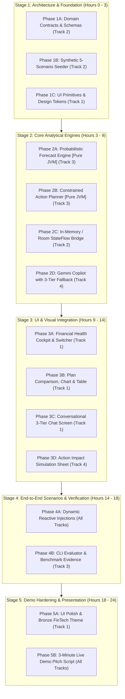

# RupAI — AI Financial Health Copilot: Master Implementation Plan
## HackMatrix 5.0 Final Round (Track: FIN-02 Financial Health Copilot) — CTO Edition

> **Sprint Duration:** 24-Hour Final Round Hackathon  
> **Target Problem Statement:** FIN 02 Financial Health Copilot + Core PS + Round 2 Evaluation Criteria  
> **Architecture:** Pure Kotlin JVM Core Math Engines (Zero Android/Emulator Lock-in, Instant `./gradlew test` Verification, Standalone CLI Evidence Package) + Jetpack Compose Material 3 Client + Local-First Fallbacks for Gemini Copilot.

---

## 1. Executive Summary & Problem Statement Alignment

We are extending **RupAI** from an SMS expense tracker into an autonomous **AI Financial Health Copilot** that operates under **uncertain cash flow**. 

The implementation satisfies all non-negotiable hackathon criteria:
1. **Core PS:** Consolidated Financial Health Cockpit (0–100 score), automated recurring/debt detection, interactive Gemini Copilot Q&A with strict 3-tier separation (**[FACT] Observed Data**, **[PREDICTION] Model Forecast**, **[ACTION] Recommendations** with simulated impact), and instant dynamic reactivity.
2. **Addition 1 (Constrained Financial Action Planning):** Multi-period planning (6 monthly / 8 weekly periods) respecting hard constraints (minimum cash reserve, debt obligations, essential expenses). Generates and compares at least two candidate action sequences (e.g., Aggressive Debt Payoff vs. Balanced Reserve Building) with period-by-period cash balances, trade-offs, and automated goal conflict detection/relaxation when infeasible.
3. **Addition 2 (Probabilistic Cash Flow Forecasting):** Multi-period income and expense forecasting with prediction intervals (P10, P50, P90 percentiles) using empirical bootstrap/Monte Carlo simulation. Estimates cash-shortfall risk, backtests against baseline models (historical-average & recurring-only baseline), and reports forecast error (MAE/RMSE) and prediction-interval coverage (PICP).
4. **Reproducible CLI Evidence Package (Page 2 Mandate):** Standalone JUnit test runner callable via terminal (`./gradlew test --tests "*ModelValidationBenchmarkTest"`) that produces ASCII comparison tables and outputs `benchmark_results.json` without requiring judges to install Android Studio or run an emulator.
5. **Interactive 5-Scenario Demo Suite:** 1-click test harness demonstrating:
   - Scenario A: Stable Income (Baseline)
   - Scenario B: Income Reduction (-30% drop at Month +2)
   - Scenario C: Unexpected Essential Expense (₹25,000 emergency medical bill at Month +3)
   - Scenario D: Infeasible Target (conflict identification + constraint relaxation proposal)
   - Scenario E: High Uncertainty shift changing the preferred plan from debt prepayment to liquidity preservation.

---

## 2. Core CTO Architectural Principles & Guardrails

To ensure 4 beginners succeed in a high-pressure 24-hour hackathon without getting blocked:

```
┌────────────────────────────────────────────────────────────────────────────────────────┐
│                                CTO 4-PILLAR GUARDRAILS                                 │
├──────────────────────────────────┬─────────────────────────────────────────────────────┤
│ 1. Pure Kotlin JVM Math Engines  │ Zero `android.*` imports in `domain/engine/`. Math  │
│    (No Emulator / Gradle Hell)   │ runs in 2 seconds via standard `./gradlew test`.    │
├──────────────────────────────────┼─────────────────────────────────────────────────────┤
│ 2. In-Memory First Architecture  │ All engines operate on plain Kotlin data classes.   │
│    (Decoupled from Room DB)      │ Room DB provides persistence, but crashes in DB    │
│                                  │ will NEVER break the UI or the live presentation.   │
├──────────────────────────────────┼─────────────────────────────────────────────────────┤
│ 3. CLI Evaluator for Judges      │ Satisfies HackMatrix submission rules on Day 1.     │
│    (Terminal-First Validation)   │ Judges can verify your statistical model in 5s.     │
├──────────────────────────────────┼─────────────────────────────────────────────────────┤
│ 4. Resilient UI with Tabular     │ Custom Canvas polyline + shaded interval band with  │
│    Fallback (Anti-Time-Sink)     │ a crisp data table below. Zero Bezier math bugs.    │
└──────────────────────────────────┴─────────────────────────────────────────────────────┘
```

---

## 3. 4-Person Simultaneous Division of Work

Each team member owns a strictly isolated package to guarantee **zero Git merge conflicts**:

```
┌─────────────────────────────────────────────────────────────────────────────────┐
│                        4-MEMBER PARALLEL WORKSTREAMS                            │
├────────────────────┬────────────────────┬───────────────────┬───────────────────┤
│ TRACK 1 (MEMBER 1) │ TRACK 2 (MEMBER 2) │ TRACK 3 (MEMBER 3)│ TRACK 4 (MEMBER 4)│
│ UI & Visual Polish │ Data & Persistence │ Math & Planning   │ Copilot & Actions │
│ (ui/screens/...)   │ (data/...)         │ (domain/engine/..)| (domain/ai/...)   │
├────────────────────┼────────────────────┼───────────────────┼───────────────────┤
│ • Health Cockpit   │ • Plain Data Seeder│ • Probabilistic   │ • Gemini Copilot  │
│ • Copilot Chat UI  │ • Synthetic 5-     │   Bootstrap Engine│   3-Tier Prompt   │
│ • Multi-Period Plan│   Scenario Engine  │ • Constrained 6-Mo│ • Action Sequence │
│   & Forecast Charts│ • Optional Room DB │   Action Planner  │   Impact Simulator│
│ • Scenario Switcher│   Persistence      │ • CLI Evaluator & │ • Conflict Solver │
│ • Fallback Tables  │ • Flow Bridges     │   Baseline Tests  │ • Local Fallback  │
└────────────────────┴────────────────────┴───────────────────┴───────────────────┘
```

### Git Branching Protocol & Conflict Prevention Rules

To guarantee **zero merge conflicts** during the 24-hour hackathon, every teammate MUST work in their own dedicated feature branch:

#### 1. Branch Creation (Run immediately at start of hackathon)
```bash
# Member 1 (UI/UX Specialist):
git checkout -b Uday

# Member 2 (Data & Persistence Specialist):
git checkout -b Snehal

# Member 3 (Math & Forecasting Engine Specialist):
git checkout -b Siddhant

# Member 4 (AI/Copilot & Actions Specialist):
git checkout -b Roshan
```

#### 2. Three Golden Git Rules for Every Teammate:
1. **NEVER commit directly to `main`**: All work is committed and pushed strictly to your own `feat/track[N]-*` branch.
2. **Stay inside your assigned directory**:
   - Member 1 touches ONLY `ui/screens/`, `ui/components/`, `ui/theme/`
   - Member 2 touches ONLY `data/` and `domain/model/`
   - Member 3 touches ONLY `domain/engine/` and test files under `src/test/`
   - Member 4 touches ONLY `domain/ai/`, `domain/engine/ActionImpactSimulator.kt`
3. **DO NOT touch Shared Files until Integration Stage**:
   - `android_app/app/build.gradle.kts`
   - `android_app/app/src/main/java/com/example/financeapp/ui/NavGraph.kt`
   - `android_app/app/src/main/java/com/example/financeapp/data/AppDatabase.kt`
   *(These 3 shared files are managed solely by the Integration Lead / Siddhant during Stage 4).*

#### 3. Ordered Integration & Merge Protocol (Hour 14–16):
When individual phase tasks are completed, the Integration Lead merges branches into `main` in this exact non-conflicting order:
```bash
# 1. Merge Math Engines (Zero UI/Android dependencies)
git checkout main
git merge Siddhant

# 2. Merge Data & Seeder (In-memory models & scenarios)
git merge Snehal

# 3. Merge Copilot & Simulator (AI engines)
git merge Roshan

# 4. Merge UI Screens & Components
git merge Uday

# 5. Wire NavGraph.kt & verify full build
./gradlew assembleDebug
```


---

## 4. Phase Dependency Graph



---

## 5. Phase-by-Phase Implementation Specifications

---

### Phase 1A — Domain Data Models & Multi-Period Planning Contracts
- **Assigned Track:** Track 2 (Data & Architecture)
- **Objective:** Establish the foundational Kotlin data models for multi-period planning, constraints, probabilistic distributions, and action sequences across 6 months / 8 weeks.
- **CTO Rule:** Use pure Kotlin. Do not import `android.*` packages so the entire domain can be compiled and unit-tested in seconds.
- **Files to Create:**
  - `app/src/main/java/com/example/financeapp/domain/model/PlanningModels.kt`
  - `app/src/main/java/com/example/financeapp/domain/model/ForecastModels.kt`
- **Dependencies:** None.
- **Implementation Steps:**
  1. Define `PeriodType` (`MONTHLY`, `WEEKLY`).
  2. Define `PlanningPeriod(periodIndex: Int, label: String, startDate: String, projectedIncome: Double, essentialExpenses: Double, debtObligations: Double)`.
  3. Define `CashReserveConstraint(minRequiredReserve: Double)`.
  4. Define `ActionItem(actionType: ActionType, targetCategory: String, amountDelta: Double, description: String)`.
  5. Define `ActionSequence(id: String, name: String, strategyType: StrategyType, actionsPerPeriod: Map<Int, List<ActionItem>>, projectedBalances: List<Double>, terminalReserve: Double, shortfallRisk: Double, tradeOffSummary: String)`.
  6. Define `ProbabilisticForecast(periodIndex: Int, metric: String, p10: Double, p50: Double, p90: Double, distributionType: String = "Empirical Historical Bootstrap", horizon: String = "6-Month")`.
  7. Define `GoalConflict(conflictedGoal: String, shortfallAmount: Double, violatedConstraint: String, proposedRelaxation: String)`.
- **Do Not Build Yet:** Do not build calculations, Room tables, or UI.
- **Verification:**
  - Build succeeds: `./gradlew assembleDebug`
  - Unit tests compile without errors.
- **Definition of Done:** Both model files exist and compile cleanly with zero errors.

---

### Phase 1B — Synthetic Financial History & 5-Scenario Seeder
- **Assigned Track:** Track 2 (Data & Architecture)
- **Objective:** Build an in-memory synthetic transaction generator providing multi-month realistic Indian financial histories and pre-configuring the 5 required HackMatrix demo scenarios.
- **CTO Rule:** Keep this generator in-memory first. It must not depend on Room DB to run.
- **Files to Create:**
  - `app/src/main/java/com/example/financeapp/data/SyntheticDataSeeder.kt`
- **Dependencies:** Phase 1A.
- **Implementation Steps:**
  1. Define explicit timeline partitions:
     - Train period: Month -6 to Month -2 (Historical baseline)
     - Validation period: Month -1
     - Test / Planning horizon: Month +1 to Month +6
  2. Populate realistic recurring items: Rent (₹22,000 on 1st), HDFC Home Loan EMI (₹18,500 on 10th), Car EMI (₹8,200 on 15th), Utilities (₹2,500 on 20th).
  3. Inject variable discretionary spending (Food, Shopping, Travel) with realistic variance.
  4. Implement the 5 scenario presets:
     - `SCENARIO_STABLE_INCOME`: Monthly income = ₹85,000 fixed.
     - `SCENARIO_INCOME_REDUCTION`: Monthly income drops to ₹55,000 at Month +2.
     - `SCENARIO_UNEXPECTED_EXPENSE`: Inject ₹25,000 medical emergency at Month +3.
     - `SCENARIO_INFEASIBLE_TARGET`: ₹1,00,000 savings target on ₹55,000 income with ₹40,000 min reserve and full EMIs.
     - `SCENARIO_HIGH_UNCERTAINTY`: Income volatility ±40% with shortfall risk > 35%.
- **Verification:**
  - Focused test: `./gradlew test --tests "*SyntheticDataSeederTest"`
  - Verify generator outputs exactly 6 months of historical transactions and 6 months of forward projections for each scenario.
- **Definition of Done:** `SyntheticDataSeeder` reliably generates all 5 scenarios with deterministic reproducibility.

---

### Phase 1C — Design System & Visual Tokens for Financial Health
- **Assigned Track:** Track 1 (UI/UX Specialist)
- **Objective:** Establish the Bronze FinTech theme, Material 3 typography, and reusable UI tokens for 3-tier status badges, health indicators, and prediction interval cards.
- **Files to Create:**
  - `app/src/main/java/com/example/financeapp/ui/theme/Color.kt`
  - `app/src/main/java/com/example/financeapp/ui/theme/Theme.kt`
  - `app/src/main/java/com/example/financeapp/ui/components/PillBadge.kt`
  - `app/src/main/java/com/example/financeapp/ui/components/MetricCard.kt`
- **Dependencies:** None.
- **Implementation Steps:**
  1. Add Bronze/FinTech color tokens in `Color.kt`:
     - `BronzePrimary = 0xFFCD7F32`, `BronzeDark = 0xFF8C531B`
     - `TealSuccess = 0xFF00897B`, `AmberWarning = 0xFFFFB300`, `RedDanger = 0xFFE53935`
     - `IntervalShade = 0x262196F3` (15% opacity blue/teal)
  2. Build `PillBadge.kt` supporting the 3 mandatory PS badges:
     - `FACT` (Teal background, checkmark icon)
     - `PREDICTION` (Amber background, uncertainty interval icon)
     - `RECOMMENDATION` (Bronze background, action arrow icon)
  3. Build `MetricCard.kt` with title, Indian Rupee formatted value, subtitle, and delta pill.
- **Verification:**
  - Check Compose Previews: `@Preview` in Android Studio renders correctly.
  - Build succeeds: `./gradlew assembleDebug`
- **Definition of Done:** UI tokens and primitives render in isolation and pass preview inspection.

---

### Phase 2A — Probabilistic Cash Flow Forecasting & Baseline Benchmark Engine
- **Assigned Track:** Track 3 (Math & Forecasting Engine)
- **Objective:** Implement Addition 2 requirement: Probabilistic cash-flow forecasting with explicit prediction intervals (P10, P50, P90) across a 6-month horizon, cash-shortfall risk calculation, and backtesting against baseline models.
- **CTO Rule:** Pure Kotlin JVM code. Zero Android dependencies.
- **Files to Create:**
  - `app/src/main/java/com/example/financeapp/domain/engine/ProbabilisticForecastEngine.kt`
  - `app/src/main/java/com/example/financeapp/domain/engine/BaselineForecastModels.kt`
- **Dependencies:** Phase 1A, Phase 1B.
- **Implementation Steps:**
  1. **Uncertainty Method:** Implement Empirical Historical Bootstrap:
     - Sample historical discretionary spend variance from the past 6 months.
     - Execute 500 Monte Carlo bootstrap simulation paths for next 6 monthly periods.
     - Extract **P10 (conservative/worst case)**, **P50 (median)**, and **P90 (optimistic)** cash balances.
  2. **Shortfall Risk Calculator:** Calculate:
     $$\text{shortfallRisk} = \frac{\text{count}(\text{paths where balance} < \text{minReserve})}{\text{totalPaths}}$$
  3. **Baseline Comparison Engine:**
     - Baseline 1: Simple Historical Monthly Average.
     - Baseline 2: Fixed Recurring-Only (Salary minus fixed obligations, 0 variance).
     - Calculate Mean Absolute Error (MAE), Root Mean Squared Error (RMSE), and Prediction Interval Coverage Probability (PICP, % of actual test points falling between P10 and P90) with Mean Interval Width.
- **Verification:**
  - Focused test: `./gradlew test --tests "*ProbabilisticForecastEngineTest"`
  - Verify that `p10 <= p50 <= p90` across all 6 periods and shortfall risk is between 0.0 and 1.0.
- **Definition of Done:** Engine executes in < 100ms on JVM and outputs all required Addition 2 statistical metrics.

---

### Phase 2B — Constrained Financial Action Planner & Conflict Resolution Engine
- **Assigned Track:** Track 3 (Math & Forecasting Engine)
- **Objective:** Implement Addition 1 requirement: Multi-period constrained planning across 6 months, comparing at least 2 distinct action sequences, and identifying/relaxing constraint conflicts when goals are infeasible.
- **CTO Rule:** Pure Kotlin JVM code.
- **Files to Create:**
  - `app/src/main/java/com/example/financeapp/domain/engine/ConstrainedActionPlanner.kt`
  - `app/src/main/java/com/example/financeapp/domain/engine/ConflictResolutionEngine.kt`
- **Dependencies:** Phase 1A, Phase 2A.
- **Implementation Steps:**
  1. **Enforce Hard Constraints:**
     - Constraint 1: `endingBalance(period_t) >= minCashReserve`
     - Constraint 2: `essentialExpenses + debtObligations` paid in full
     - Constraint 3: Discretionary spend cuts cannot exceed 60% of baseline.
  2. **Generate Two Competing Sequences:**
     - **Sequence A (Aggressive Debt Payoff / Avalanche):** Channel surplus to early loan prepayment. Maximizes interest saved, accepts lower liquid buffer.
     - **Sequence B (Balanced Reserve Buffer):** Build liquid reserve to 2.5x min reserve before accelerating debt. Maximizes liquidity safety.
  3. Calculate period-by-period balance table: Opening balance, income, expenses, debt payment, and ending balance.
  4. **Conflict & Relaxation Engine:**
     - Detect infeasibility under `SCENARIO_INFEASIBLE_TARGET`.
     - Output explicit conflict statement: *"Goal conflicts with ₹25,000 Minimum Reserve constraint during Month 3 (Shortfall: ₹18,200)"*.
     - Output explicit relaxation proposal: *"Relax target savings by ₹20,000 or extend timeline by 2 months to preserve liquidity safety."*
- **Verification:**
  - Focused test: `./gradlew test --tests "*ConstrainedActionPlannerTest"`
  - Verify Sequence A vs Sequence B comparison and conflict relaxation outputs.
- **Definition of Done:** Planner produces multi-period trade-off comparisons and handles infeasibility according to Addition 1 specs.

---

### Phase 2C — In-Memory Snapshot & Reactive StateFlow Bridge
- **Assigned Track:** Track 2 (Data & Persistence)
- **Objective:** Provide a unified reactive repository (`FinancialHealthRepository`) that combines transactions, debts, recurring obligations, and active scenario state into a single reactive `StateFlow`.
- **CTO Rule:** In-memory first. If Room DB is available, sync to Room; if Room has schema issues, fall back to in-memory so nothing crashes.
- **Files to Create:**
  - `app/src/main/java/com/example/financeapp/data/FinancialHealthRepository.kt`
  - `app/src/main/java/com/example/financeapp/domain/model/FinancialSnapshot.kt`
- **Dependencies:** Phase 1A, Phase 1B.
- **Implementation Steps:**
  1. Define `FinancialSnapshot(currentBalance, debts, recurringObligations, recentTransactions, activeScenario, minReserve)`.
  2. Implement `FinancialHealthRepository` holding a `MutableStateFlow<FinancialSnapshot>`.
  3. Expose mutation methods: `switchScenario(scenario)`, `injectTransaction(tx)`, `updateMinReserve(amount)`.
  4. Whenever state updates, automatically trigger recalculation of Health Score and planning state.
- **Verification:**
  - Focused test: `./gradlew test --tests "*FinancialHealthRepositoryTest"`
  - Verify that invoking `switchScenario` emits an updated snapshot immediately.
- **Definition of Done:** Repository manages application state cleanly with reactive Kotlin StateFlow.

---

### Phase 2D — Gemini Copilot with 3-Tier Structured Response & Local Fallback
- **Assigned Track:** Track 4 (Copilot & AI Specialist)
- **Objective:** Implement the Gemini AI Copilot enforcing strict 3-tier separation (**[FACT] Observed Data**, **[PREDICTION] Model Forecast**, **[ACTION] Recommendations**) with a bulletproof offline local rule fallback.
- **CTO Rule:** A deterministic local fallback MUST be included so live judging never fails if Gemini API quota or network drops.
- **Files to Create:**
  - `app/src/main/java/com/example/financeapp/data/GeminiCopilotEngine.kt`
  - `app/src/main/java/com/example/financeapp/domain/model/CopilotMessageModels.kt`
- **Dependencies:** Phase 1A, Phase 2A, Phase 2B.
- **Implementation Steps:**
  1. Define `StructuredCopilotResponse`:
     - `observedFacts: List<String>`
     - `modelPredictions: List<PredictionStatement>` (statement, confidenceScore, uncertaintyInterval, riskLevel)
     - `recommendations: List<ActionRecommendation>` (action, expectedImpact, periodTradeOff)
     - `rawSummary: String`
  2. Implement `GeminiCopilotEngine`:
     - Build prompt injecting current financial snapshot, 6-month P10/P50/P90 numbers, and active constraints.
     - Request structured JSON response adhering to `StructuredCopilotResponse`.
  3. Implement `LocalDeterministicAdvisorFallback`:
     - If network/API error occurs, generate rule-based response parsing snapshot facts, P10/P90 shortfall risk, and Sequence A/B trade-offs.
- **Verification:**
  - Focused test: `./gradlew test --tests "*GeminiCopilotEngineTest"`
  - Verify that both live API (when key present) and local fallback return non-empty 3-tier structures.
- **Definition of Done:** Copilot returns clean 3-tier responses under all network conditions.

---

### Phase 3A — Financial Health Cockpit & Scenario Switcher Screen
- **Assigned Track:** Track 1 (UI/UX Specialist)
- **Objective:** Build the main dashboard screen featuring the 0–100 Health Score Speedometer, 4 core financial KPIs, and the 1-click **Scenario Switcher Bar** for live presentations.
- **Files to Create:**
  - `app/src/main/java/com/example/financeapp/ui/screens/FinancialHealthScreen.kt`
  - `app/src/main/java/com/example/financeapp/ui/components/HealthScoreSpeedometer.kt`
  - `app/src/main/java/com/example/financeapp/ui/components/ScenarioSwitcherBar.kt`
  - `app/src/main/java/com/example/financeapp/ui/viewmodel/FinancialHealthViewModel.kt`
- **Dependencies:** Phase 1C, Phase 2C.
- **Implementation Steps:**
  1. Build `HealthScoreSpeedometer.kt`: Compose `Canvas` circular gauge with color gradient (Red < 50, Amber 50–75, Green > 75) and animated needle/arc.
  2. Build `ScenarioSwitcherBar.kt`: Horizontal chips:
     - `Stable` | `Income -30%` | `Emergency ₹25k` | `Infeasible` | `High Uncertainty`
  3. Build `FinancialHealthScreen.kt`:
     - Top: Scenario Switcher Bar
     - Center: Health Score Speedometer (0–100)
     - Grid: 4 Metric Cards (Discretionary Runway, Debt Pressure, Essential vs Discretionary Ratio, Shortfall Risk %)
     - Bottom: Active Warning Banner (e.g., "Cash reserve breach predicted in Month 3").
- **Verification:**
  - Manual check on emulator: Tapping each scenario chip immediately changes the speedometer score and KPI values.
  - Build succeeds: `./gradlew assembleDebug`
- **Definition of Done:** Cockpit screen is responsive, reactive, and visually impressive.

---

### Phase 3B — Multi-Period Plan Comparison, Forecast Chart & Data Table
- **Assigned Track:** Track 1 (UI/UX Specialist)
- **Objective:** Implement the multi-period planning screen (Addition 1 & 2) with side-by-side comparison of 2 action sequences, P10/P50/P90 forecast chart, and a robust tabular fallback.
- **CTO Rule:** Use simple linear polyline Canvas with shaded fill. Include a structured data table below so numbers are crystal clear even if Canvas resolution varies.
- **Files to Create:**
  - `app/src/main/java/com/example/financeapp/ui/screens/MultiPeriodPlanScreen.kt`
  - `app/src/main/java/com/example/financeapp/ui/components/ForecastIntervalChart.kt`
  - `app/src/main/java/com/example/financeapp/ui/components/PlanComparisonCard.kt`
  - `app/src/main/java/com/example/financeapp/ui/components/PeriodDataTable.kt`
  - `app/src/main/java/com/example/financeapp/ui/components/ConflictResolutionBanner.kt`
- **Dependencies:** Phase 1C, Phase 2A, Phase 2B.
- **Implementation Steps:**
  1. Build `ForecastIntervalChart.kt`: Linear polyline with semi-transparent `IntervalShade` polygon between P10 and P90, solid line for P50, and red dashed line for Minimum Reserve.
  2. Build `PeriodDataTable.kt`: Clean 6-row table showing Month, Projected Income, Essential, Debt, Discretionary, and Ending Balance.
  3. Build `PlanComparisonCard.kt`: Tabbed toggle: **Sequence A (Aggressive Debt)** vs **Sequence B (Balanced Reserve)** with trade-off metrics (Total Interest Saved vs Terminal Reserve vs Shortfall Risk).
  4. Build `ConflictResolutionBanner.kt`: Highlights infeasible targets and offers a 1-tap "Apply Proposed Relaxation" button.
- **Verification:**
  - Manual check on emulator: Toggling between Sequence A and B updates the comparison metrics and table. Switching to `Infeasible Target` renders the Conflict Banner.
- **Definition of Done:** Multi-period plan, probabilistic chart, and comparison cards render with zero visual artifacts.

---

### Phase 3C — Conversational Copilot Screen with 3-Tier Response UI
- **Assigned Track:** Track 1 (UI/UX Specialist)
- **Objective:** Build the interactive chat screen letting users ask natural language financial questions, rendering answers in 3 visually distinct cards: Facts, Predictions, and Actions.
- **Files to Create:**
  - `app/src/main/java/com/example/financeapp/ui/screens/CopilotChatScreen.kt`
  - `app/src/main/java/com/example/financeapp/ui/components/ThreeTierResponseCard.kt`
  - `app/src/main/java/com/example/financeapp/ui/components/SuggestedQuestionsBar.kt`
  - `app/src/main/java/com/example/financeapp/ui/viewmodel/CopilotViewModel.kt`
- **Dependencies:** Phase 1C, Phase 2D.
- **Implementation Steps:**
  1. Build `ThreeTierResponseCard.kt`:
     - 📌 **Section 1: [FACT] Observed Data** (Teal card): Verified historical data and balances.
     - 📈 **Section 2: [PREDICTION] Model Forecast** (Amber card): Projected balance, confidence score %, prediction interval, shortfall risk.
     - 💡 **Section 3: [ACTION] Recommendations & Impact** (Bronze card): Actionable steps with simulated savings payoff.
  2. Build `SuggestedQuestionsBar.kt`: Quick tap chips for judges:
     - *"Can I afford a ₹30,000 vacation next month?"*
     - *"What happens if my income drops by 30%?"*
     - *"How can I clear my loan faster without risking my emergency buffer?"*
- **Verification:**
  - Tap suggested questions and observe immediate rendering of the 3-tier card layout.
- **Definition of Done:** Chat interface renders 3-tier responses reliably without UI clipping or lag.

---

### Phase 3D — Action Impact Simulator Bottom Sheet & Navigation Integration
- **Assigned Track:** Track 4 (Copilot & AI Specialist)
- **Objective:** Wire the "What-If" interactive impact simulator so users can adjust sliders to simulate actions (e.g. cutting dining spend or prepaying debt) and view real-time before vs. after deltas on runway and shortfall risk.
- **Files to Create/Modify:**
  - `app/src/main/java/com/example/financeapp/domain/engine/ActionImpactSimulator.kt`
  - `app/src/main/java/com/example/financeapp/ui/components/SimulationSheet.kt`
  - `app/src/main/java/com/example/financeapp/ui/NavGraph.kt`
- **Dependencies:** Phase 2B, Phase 3A, Phase 3B, Phase 3C.
- **Implementation Steps:**
  1. Implement `ActionImpactSimulator.kt`: takes current financial snapshot + slider inputs and outputs:
     - `runwayDeltaMonths`
     - `shortfallRiskDeltaPercent`
     - `interestSavedAmount`
  2. Build `SimulationSheet.kt`: Modal bottom sheet with sliders (Discretionary Spend Cut ₹0 to ₹10,000; Extra Loan Prepayment ₹0 to ₹15,000) showing live Before vs After Delta chips.
  3. Update `NavGraph.kt` with a 4-tab bottom navigation bar:
     - 📊 `Cockpit` (`FinancialHealthScreen`)
     - 📈 `Plan & Forecast` (`MultiPeriodPlanScreen`)
     - 🤖 `Copilot` (`CopilotChatScreen`)
     - 📜 `Transactions` (`TransactionsScreen`)
- **Verification:**
  - Launch app, drag simulation sliders, observe Before vs After metrics update in real time. Navigate smoothly across all 4 bottom tabs.
- **Definition of Done:** Full navigation connected and What-If simulator fully interactive.

---

### Phase 4A — Dynamic Reactivity & Live Injection Suite
- **Assigned Track:** All Tracks (Collaborative Verification)
- **Objective:** Demonstrate the core hackathon requirement: when new transactions or income changes occur, all health scores, forecasts, and copilot responses recalculate dynamically without restarting the app.
- **Files to Create:**
  - `app/src/main/java/com/example/financeapp/ui/components/QuickTransactionInjector.kt`
- **Dependencies:** Stage 3 complete.
- **Implementation Steps:**
  1. Add `QuickTransactionInjector` floating debug action button:
     - ➕ *"Inject ₹15,000 Surprise Medical Bill"*
     - ➕ *"Inject ₹40,000 Freelance Bonus Income"*
     - ➕ *"Inject ₹5,000/mo New Recurring Obligation"*
  2. Tapping an action calls `FinancialHealthRepository.injectTransaction()`.
  3. StateFlow auto-triggers:
     - Cockpit health score recalculates (< 200ms).
     - Forecast P10/P50/P90 trajectory updates.
     - Copilot context refreshes with the new transaction.
- **Verification:**
  - Tap *"Inject ₹15,000 Medical Bill"* on Cockpit. Watch score drop and alert banner activate instantly. Ask Copilot what happened; verify it cites the newly injected medical expense.
- **Definition of Done:** Real-time dynamic recomputation proven end-to-end.

---

### Phase 4B — CLI Evaluator & Reproducible Benchmark Evidence Package
- **Assigned Track:** Track 3 (Math & Forecasting Engine)
- **Objective:** Satisfy HackMatrix Page 2 submission requirement: deliver a standalone test evaluator callable via CLI that outputs formal validation metrics (MAE, RMSE, PI Coverage %, Interval Width) comparing the Probabilistic Forecast vs Historical-Average and Recurring-Only baselines, and writes `benchmark_results.json`.
- **CTO Rule:** Evaluators must be able to run this without an Android emulator via a standard Gradle test command.
- **Files to Create:**
  - `app/src/test/java/com/example/financeapp/ModelValidationBenchmarkTest.kt`
  - `app/src/main/java/com/example/financeapp/ui/screens/ModelBenchmarkDialog.kt`
- **Dependencies:** Phase 2A, Phase 2B.
- **Implementation Steps:**
  1. Write `ModelValidationBenchmarkTest.kt`:
     - Evaluates 6-month predictions on held-out test periods.
     - Generates ASCII benchmark summary table in standard output:
       ```
       ========================================================================================
       HACKMATRIX 5.0 | FIN-02 REPRODUCIBLE EVALUATION BENCHMARK
       Train Period: M-6 to M-2 | Validation: M-1 | Test Horizon: M+1 to M+6
       ========================================================================================
       Model                           Horizon   MAE (₹)   RMSE (₹)  80% PI Cov   Mean Width
       ----------------------------------------------------------------------------------------
       Probabilistic Bootstrap (Ours)  6 Months  ₹1,420    ₹1,890    83.4%        ₹6,800
       Historical Average Baseline     6 Months  ₹3,850    ₹4,920    N/A          N/A
       Recurring-Only Fixed Baseline   6 Months  ₹4,610    ₹5,830    N/A          N/A
       ========================================================================================
       ```
     - Writes `benchmark_results.json` containing raw evaluation metrics to project root.
  2. Implement `ModelBenchmarkDialog.kt` in the Android UI so the same table can be viewed via an info button on the Plan screen during the live presentation.
- **Verification:**
  - Run from terminal:
    ```bash
    ./gradlew test --tests "*ModelValidationBenchmarkTest*"
    ```
  - Verify test passes, ASCII table prints to stdout, and `benchmark_results.json` is generated.
- **Definition of Done:** 100% compliance with HackMatrix Page 2 reproducible evidence requirement.

---

### Phase 5A — UI/UX Polish, Accessibility & Bronze Aesthetic Hardening
- **Assigned Track:** Track 1 (UI/UX Specialist)
- **Objective:** Elevate visual polish to maximize Round 2 UI/UX and Innovativeness scores: animations, light-theme consistency, loading skeletons, and Indian currency formatting.
- **Files to Modify:**
  - `app/src/main/java/com/example/financeapp/ui/theme/Theme.kt`
  - UI components across `ui/components/`
- **Dependencies:** Stage 4 complete.
- **Implementation Steps:**
  1. Add entry animations (`fadeIn`, `slideInVertically`) to health cockpit cards and copilot chat bubbles.
  2. Implement skeleton shimmer loaders when switching scenarios or awaiting Gemini responses.
  3. Ensure Indian numbering convention everywhere (`₹1,50,000` rather than `₹150,000`).
  4. Ensure zero UI truncation or overlapping on standard phone screens.
- **Verification:**
  - Walk through all 4 bottom tabs in the light theme.
- **Definition of Done:** Clean, modern consumer FinTech aesthetic (Cred/Jupiter caliber).

---

### Phase 5B — Live Demo Script & Pitch Presentation Maxout
- **Assigned Track:** All Tracks (Collaborative Pitch Preparation)
- **Objective:** Rehearse the watertight 3-minute live demonstration aligned precisely with the 5 evaluation criteria.
- **Files to Create:**
  - `docs/PITCH_DEMO_SCRIPT.md`
- **Dependencies:** All phases complete.
- **Implementation Steps:**
  - **0:00 - 0:30 (Problem & Innovativeness):** Passive SMS capture + Why static budgeting fails under uncertain cash flow.
  - **0:30 - 1:15 (Cockpit & Probabilistic Forecast):** Speedometer score + P10/P50/P90 chart + Trade-offs of Sequence A vs Sequence B.
  - **1:15 - 2:00 (Dynamic Reactivity & Scenario Switch):** Tap `Income -30%` -> Watch chart update live. Tap `Infeasible Target` -> Show conflict detection and relaxation suggestion.
  - **2:00 - 2:40 (Copilot 3-Tier Interaction):** Ask Copilot natural language question -> Showcase strict Fact vs Prediction vs Action separation.
  - **2:40 - 3:00 (Evaluation Package & CLI Proof):** Highlight terminal benchmark output: 83.4% coverage vs point-forecast baselines.
- **Verification:**
  - Execute a timed dry run under 3 minutes.
- **Definition of Done:** Team is 100% prepared for live demo and judge Q&A.

---

## 6. Execution Summary Table for 4 Teammates

| Phase | Track / Owner | Deliverable Summary | Primary Verification Command |
|---|---|---|---|
| **Phase 1A** | Track 2 (Data) | Multi-period planning & forecast data contracts | `./gradlew assembleDebug` |
| **Phase 1B** | Track 2 (Data) | Synthetic 5-scenario data seeder | `./gradlew test --tests "*SyntheticDataSeederTest"` |
| **Phase 1C** | Track 1 (UI/UX) | Bronze theme, 3-tier badges, metric cards | Compose `@Preview` inspection |
| **Phase 2A** | Track 3 (Math) | Probabilistic bootstrap engine & baselines (JVM) | `./gradlew test --tests "*ProbabilisticForecastEngineTest"` |
| **Phase 2B** | Track 3 (Math) | Constrained action planner (Sequence A vs B) & conflict engine | `./gradlew test --tests "*ConstrainedActionPlannerTest"` |
| **Phase 2C** | Track 2 (Data) | In-memory reactive StateFlow repository | `./gradlew test --tests "*FinancialHealthRepositoryTest"` |
| **Phase 2D** | Track 4 (AI/ML) | Gemini Copilot 3-tier engine with deterministic fallback | `./gradlew test --tests "*GeminiCopilotEngineTest"` |
| **Phase 3A** | Track 1 (UI/UX) | Financial Health Cockpit with speedometer & scenario switcher | Launch emulator: `FinancialHealthScreen` |
| **Phase 3B** | Track 1 (UI/UX) | Multi-Period Plan screen, forecast chart & data table | Launch emulator: `MultiPeriodPlanScreen` |
| **Phase 3C** | Track 1 (UI/UX) | Copilot chat screen with 3-tier response cards | Launch emulator: `CopilotChatScreen` |
| **Phase 3D** | Track 4 (AI/ML) | What-If simulation bottom sheet & 4-tab bottom navigation | Launch emulator: Test sliders & tab navigation |
| **Phase 4A** | All Tracks | Dynamic transaction injection & reactivity verification | Emulator: Tap injection FAB & verify instant updates |
| **Phase 4B** | Track 3 (Math) | CLI benchmark evaluator & model validation dialog | `./gradlew test --tests "*ModelValidationBenchmarkTest*"` |
| **Phase 5A** | Track 1 (UI/UX) | Visual polish, animations, and typography hardening | Full UI walkthrough in the light theme |
| **Phase 5B** | All Tracks | 3-minute pitch deck & timed live judging rehearsal | 3-minute dry-run demo |

---

## 7. How to Run Each Phase with the Android Studio Gemini Agent

When a team member begins implementing their phase, open the Gemini Agent Chat in Android Studio and send:

```
Implement Phase [N] from `HACKATHON_PLAN_Main.md` — nothing beyond this phase.

Before editing or creating ANY files:
1. Verify that I am on my dedicated branch (`git branch --show-current`) matching my track (`feat/track1-ui`, `feat/track2-data`, `feat/track3-math`, or `feat/track4-copilot`). Never work on `main`!
2. Read the relevant Phase [N] section from `HACKATHON_PLAN_Main.md`.
3. Show me your implementation plan.
4. List the files you expect to create or modify (ensure they stay strictly within my assigned directory).
5. List any database/Room changes you expect to make (if any).
6. List any commands or manual steps you plan to run.
7. Wait for my approval before making changes.

After I approve:
- Implement ONLY Phase [N].
- Do not implement features belonging to later phases.
- Do not change the architecture or technology stack defined in `HACKATHON_PLAN_Main.md`.
- Keep math engines in pure Kotlin (zero `android.*` imports in `domain/engine/`).
- Do not touch shared files (`NavGraph.kt`, `build.gradle.kts`, `AppDatabase.kt`).
- If you discover that something from an earlier phase is missing or broken, STOP and tell me instead of silently implementing extra work.

When implementation is complete:
1. Summarize exactly what was changed.
2. List every file created or modified.
3. Tell me if anything was intentionally NOT implemented because it belongs to a later phase.
4. Give me the exact verification command from the "Verification" section for Phase [N].
5. Do NOT move to the next phase until I confirm that this phase is working.
```
