# AI-Powered Financial Expense Tracker

**Target Audience:** Engineering Student Portfolio / Hackathon Project

## Overview
A comprehensive blueprint for an automated financial expense tracking application that leverages AI to parse and categorize transactions directly from SMS notifications. This project is designed as a zero-cost production stack optimized for engineering students.

## Core Features
1. **Automated Real-Time Transaction Extraction:** Parses local SMS databases to identify financial transactions.
2. **Smart AI Categorization:** Uses generative AI to classify expenses into budget categories.
3. **Personal Financial Insights & Advice:** Delivers real-time financial coaching.
4. **Simple Visual Dashboards:** Provides easy-to-read financial charts and summaries.
5. **High Security & Privacy:** Keeps user data isolated and secure through robust authentication and row-level security.

## Production Tech Stack (Zero-Cost Blueprint)
This stack utilizes enterprise-grade technologies with robust free developer tiers, requiring zero upfront cloud costs.

### Frontend Mobile Client
* **Framework:** Kotlin utilizing Jetpack Compose OR Flutter utilizing Dart.
* **Sync Execution Pattern:** "Sync on App Open". The app queries the local Android SMS system database upon launch to process only the differential delta since the last sync, ensuring maximum battery efficiency and zero friction from background execution limiters.

### Backend API Gateway
* **Framework:** Python 3.11+ (FastAPI)
* **Responsibilities:** Handles client API requests, executes Regular Expression (Regex) input sanitation to isolate transaction details, signs communications, and safely routes data.
* **Hosting:** Render (`render.com`) or Railway (`railway.app`)

### Cloud Database & User Management
* **Provider:** Supabase Cloud
* **Engine:** Relational PostgreSQL
* **Features:** 500 MB free storage, fully integrated JWT User Authentication (Google Sign-In), and Row-Level Security (RLS) policies.

### Semantic AI Classification Engine
* **Provider:** Google AI Studio (Gemini API)
* **Model:** `gemini-2.5-flash` or `gemini-flash-lite`
* **Utility:** Accepts sanitized transaction strings (merchants, values) and returns structured JSON schemas mapped to budgetary configurations (e.g., Food, Utilities, Transport, Rent) along with financial insights.

## Core Implementation Data Workflow
To maintain a smooth 60 FPS user experience, processing of historical transactions is offloaded from the main UI thread.

1. **App Launch:** Initialize the application environment.
2. **Show Loading Spinner:** Display a visual indicator while the UI thread remains free.
3. **Query Local System SMS DB:** Pull messages matching Bank IDs received since the last sync timestamp.
4. **Thread Switch / Offload:** Shift execution to background workers (Flutter Isolates or Kotlin Coroutines).
5. **Run Regex Parser:** Extract transaction amount, merchant text, and account identifiers from raw SMS data.
6. **API Request to Backend:** Send the processed payload to the FastAPI backend, which forwards it to Gemini AI Studio.
7. **AI JSON Categorization:** AI returns structured categories (e.g., "Food", "Bills").
8. **Update Supabase & Local DB:** Save categorized records permanently in cloud and local storage.
9. **Switch back to Main UI Thread:** Return control to the primary thread.
10. **Hide Spinner & Update Charts:** Remove the loading indicator and refresh the financial dashboards with new data.

### Workflow Diagram

```mermaid
flowchart TB
    subgraph Row1[" "]
        direction LR
        A["🚀 1. App Launch<br/><br/>System initializes the<br/>application environment."]
        B["⏳ 2. Show Loading Spinner<br/><br/>Visual indicator displays;<br/>UI thread free at 60 FPS."]
        C["🗄️ 3. Query Local System SMS DB<br/><br/>Pulls bank messages received<br/>since last sync timestamp."]
        D["⚙️ 4. Thread Switch / Offload<br/><br/>Shifts off main thread to<br/>background worker/Isolates."]
        E["🔍 5. Run Regex Parser<br/><br/>Extracts transaction amount,<br/>merchant, and account ID."]
        A --> B --> C --> D --> E
    end
    
    subgraph Row2[" "]
        direction LR
        F["🌐 6. API Request to Backend<br/><br/>Processes payload and forwards<br/>to FastAPI & Gemini AI."]
        G["🧠 7. AI JSON Categorization<br/><br/>AI returns structured<br/>categories ('Food', 'Bills')."]
        H["☁️ 8. Update Supabase & Local DB<br/><br/>Saves records permanently<br/>to cloud and local."]
        I["🔄 9. Switch back to Main UI Thread<br/><br/>Control is returned to<br/>primary thread for the UI."]
        J["📊 10. Hide Spinner & Update Charts<br/><br/>Removes loading indicator;<br/>refreshes dashboards."]
        F --> G --> H --> I --> J
    end

    E --> F

    style Row1 fill:none,stroke:none
    style Row2 fill:none,stroke:none

    style A fill:#e6f3ff,stroke:#333,stroke-width:2px,color:#000
    style B fill:#eaffea,stroke:#333,stroke-width:2px,color:#000
    style C fill:#ffffe6,stroke:#333,stroke-width:2px,color:#000
    style D fill:#f4e6ff,stroke:#333,stroke-width:2px,color:#000
    style E fill:#e6ffff,stroke:#333,stroke-width:2px,color:#000
    style F fill:#ffe6cc,stroke:#333,stroke-width:2px,color:#000
    style G fill:#ffe6f3,stroke:#333,stroke-width:2px,color:#000
    style H fill:#e6f9ff,stroke:#333,stroke-width:2px,color:#000
    style I fill:#e6eeff,stroke:#333,stroke-width:2px,color:#000
    style J fill:#eafaf1,stroke:#333,stroke-width:2px,color:#000
```

