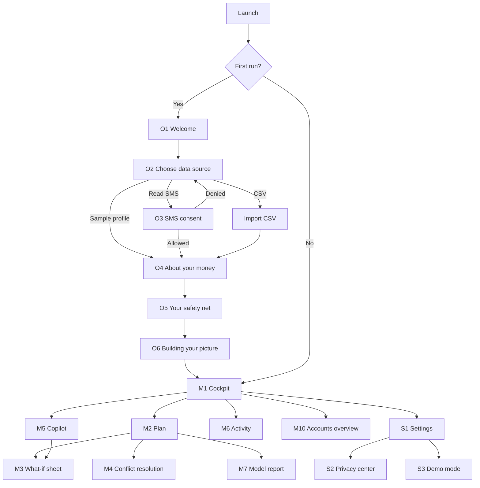

# 07 - UI/UX Flow

**Related docs:** [02 Pages](02-pages.md) · [03 Target audience](03-target-audience.md) · [05 Frontend UI style](05-frontend-ui-style.md) · [09 Overall plan](09-overall-plan.md)

How people move through the app, what they see at each step, and what happens when things go wrong. Screen IDs (O1, M1, and so on) match [02 Pages](02-pages.md).

---

## 1. Experience goals

| Goal | How the flow delivers it |
|---|---|
| First verdict in under three minutes | Short onboarding with three questions; sample profile as a one-tap shortcut |
| Always know "am I okay?" | The Cockpit opens with a verdict, not a report |
| Trust through transparency | Statement tags, ranges, completeness meter, privacy center |
| Change one thing, see the effect | What-if sheet, replan with a "what changed" summary |
| Never stuck | Every failure has a fallback path (SMS denied, no data, AI offline) |

## 2. Flow map

## 3. Core journeys

### J1. First run to first verdict
1. **O1 Welcome.** Reads the promise and the three privacy lines. Taps "Get started".
2. **O2 Choose data source.** Selects Read bank SMS, Upload CSV or Try a sample profile.
3. **O3 SMS consent** (SMS path). Reads what is and is not read. Taps "Allow SMS access"; the system dialog appears.
4. **O4 About your money.** Three quick steps (income type, fixed payments, optional age range).
5. **O5 Your safety net.** Sets the minimum cushion; optionally a goal and loan details. "Skip anything you don't know."
6. **O6 Building your picture.** Watches the checklist finish. Sees the completeness summary, for example "1 bank account, 1 card, 2 loans, 1 SIP, 3 repeat payments and 1 income source found. Missing: car loan rate."
7. **M1 Cockpit.** Lands on the verdict card.

**Success:** the user reaches a verdict with no dead ends. **Time target:** under three minutes on the sample profile, under five with SMS.

### J2. Daily check ("am I okay?")
1. Open the app to the Cockpit.
2. Read the verdict line and the confidence chip.
3. Glance at the accounts row (cash, card dues, loan EMIs, SIP) and the 30-day obligations timeline; tap a marker for details (M6b) or a pill for the accounts overview (M10).
4. If an alert banner is shown, tap "See plan" to M2.

### J3. Ask the Copilot ("Can I afford a ₹30,000 vacation next month?")
1. Open Copilot; tap a suggestion chip or type a question.
2. A skeleton card shows "Calculating...".
3. The answer appears as three sections:
   - **Observed:** current cash across accounts, card dues, and what is committed next month (EMIs, rent, SIP).
   - **Predicted:** balance range after the trip, shortfall chance, confidence.
   - **Recommended:** options (for example, split over two months) with impact.
4. Tap "Simulate this" to open M3 prefilled, or "Add to plan".

### J4. Compare plans and choose
1. Open Plan (M2). The recommended plan is preselected, with a "Why this plan" line.
2. Switch between Plan A, Plan B and Status quo; the chart and table update.
3. Tap Compare to see A and B side by side.
4. Tap "Apply plan". A confirmation says "Plan applied" and the Cockpit reflects it.

### J5. Replan after a change (income drops, bill arrives)
1. The user edits income in settings, adds an expense (M9), or a new transaction arrives.
2. The app recomputes forecast, plans and verdict.
3. A "What changed" snackbar or card appears: "Shortfall risk rose from 6% to 31%. Recommended plan switched to B."
4. If the goal is no longer feasible, the conflict banner appears (J6).

### J6. Resolve a conflict
1. The banner on M2 states the conflict with numbers: "Your goal of ₹1,00,000 breaks your ₹40,000 cushion in Month 3 by ₹18,200."
2. Tap it to open M4 with three computed options: lower the target, extend the timeline, reduce the cushion (flagged "Not recommended" if too low). When an SIP exists, a fourth option appears: reduce or pause the SIP.
3. Each option shows its effect on shortfall risk.
4. "Apply proposed relaxation" updates the plan; "Keep my target and show what breaks" shows the failing periods.

### J7. Add missing information and watch the forecast narrow
1. The completeness card on the Cockpit lists "What we don't know" (for example, loan balance).
2. Tap "Add loan details"; fill the fields.
3. The forecast recomputes; the band narrows and the confidence chip may rise from Medium to High. A summary states what changed.

### J8. Fix a wrong category or repeating payment
1. Activity > transaction row > detail sheet (M6a).
2. Change category; check "Apply to all from this merchant".
3. Toggle "Treat as repeating payment" if needed.
4. Snackbar "Updated 6 transactions" with Undo.

### J9. Privacy: review, export or delete
1. Settings > Privacy center (S2).
2. Review consent toggles and the "What left your phone" log.
3. Export my data, or Delete my data: a dialog asks the user to type DELETE to confirm; after deletion the app returns to O1.

### J10. Demo (judge mode)
1. Settings > Judge mode on. The top bar shows "Demo data".
2. S3 shows scenario chips and injector buttons.
3. Tapping a scenario updates all screens live; Reset restores the baseline.

### J11. See where my money sits
1. On the Cockpit, read the accounts row under the health score: Cash, Card dues, Loan EMIs, SIP.
2. Tap a pill. The accounts overview (M10) opens with four groups: bank accounts, cards, loans, SIPs.
3. A stale balance shows a Watch pill; a missing detail shows "Rate missing. Add it to narrow the forecast".
4. Tap "Edit details" to add it (S1a). The sheet closes, the forecast recomputes and a "What changed" line appears.
5. Back on the Cockpit, the pill amounts and the verdict reflect the change.

## 4. Three-minute live demo, mapped to screens

| Time | Screen | What is shown | Requirement covered |
|---|---|---|---|
| 0:00-0:30 | O1, O2, M1 | The problem, the privacy promise, a verdict and the accounts row (cash, cards, loans, SIP) on a sample profile | Product value, consolidation, privacy |
| 0:30-1:15 | M1, M2 | Obligations timeline, fan chart, Plan A vs B with risk and trade-offs, "Why this plan" | Addition 1 and 2, trust labels |
| 1:15-2:00 | S3, M2, M4 | Scenario Income -30%: chart and recommendation change; scenario Infeasible target: computed conflict and relaxation | Replan, conflict detection |
| 2:00-2:40 | M5 | Ask a question: Observed, Predicted, Recommended with impact; "Simulate this" | Conversational answers, impact |
| 2:40-3:00 | M7 | Terminal: Gradle test output, evidence pack export; baselines vs ours | Evaluation and evidence |

Required demonstration cases (stable income, income reduction, unexpected essential expense, infeasible target, uncertainty changes the preferred plan) are each one tap in S3. See [06 Backend](06-backend.md), section 12.3.

## 5. Navigation rules

- Four tabs always reachable from any main screen: Cockpit, Plan, Copilot, Activity.
- Sheets (what-if, explainers, detail) open over the current screen; system back dismisses the sheet first.
- Settings is reached from the top-bar overflow menu on every tab.
- Deep links: notification "due soon" opens the obligation sheet (M6b); notification "risk crossed" opens M2.
- Returning users skip onboarding. Declared inputs can be edited later in S1a.
- Tab state is preserved when switching tabs (scroll position, selected plan).

## 6. States and edge cases

| Situation | What the user sees | Next step offered |
|---|---|---|
| SMS permission denied | Calm explanation: "You can still use the app without SMS." | Upload CSV, or try a sample profile |
| SMS permission permanently denied | Same, plus how to change it in system settings | Open settings button |
| No messages found | "We didn't find bank messages on this phone." | CSV, sample, or add manually |
| Thin history (under 3 months) | Low confidence chip, wide band, note "More history will narrow this" | Add data, or continue |
| Parsing uncertainty | "Possible repeating payment" with a confirm or dismiss | Confirm, edit, dismiss |
| Missing key input | Completeness card and wider band | One-tap add |
| Account balance older than 7 days | Watch pill on the Cash pill and in M10; completeness drops | Add a fresh balance or confirm it |
| SIP amount changed or a SIP debit is missed | "Possible change to your SIP" with the old and new amounts | Confirm, edit, dismiss |
| Card statement not found | Dues shown from the unbilled amount, labelled "estimate" | Add the statement due date and minimum due |
| Offline or AI unavailable | On-device answer with notice "Gemini is unavailable. Showing on-device advice." | Retry |
| Verifier rejects narration | Template answer from the same engine numbers | None needed |
| Infeasible goal | Conflict banner and M4 | Apply a relaxation |
| No plan meets the risk limit | Banner "No plan meets your risk limit. Showing the lowest-risk option." | See what-if, adjust the limit |
| Computation slow | Skeleton and "Calculating..." for up to a few seconds | Wait; cancel resets to last result |
| Data deleted | Return to O1 | Start again |

## 7. Microinteractions

| Moment | Behaviour |
|---|---|
| Verdict and score on first load | Count-up over 600ms, once |
| Forecast band | Draws left to right once, then stays still |
| Plan switch | Chart cross-fades (200ms); table rows update in place |
| What-if sliders | Before and after chips update live; light haptic on release |
| Apply plan / Confirm | Light haptic and a snackbar confirming the same action name |
| Scenario switch (Demo mode) | Skeleton for under a second, then values settle |
| New data arrives | A small "Updated" pill under the verdict, fading after 3 seconds |
| Reduced motion | All animation replaced by instant changes |

## 8. Content patterns

- **Verdict card:** status icon, one sentence, range, confidence, one action.
- **Warning pattern:** what is happening, when, a number, and a next step.
- **Prediction pattern:** a range, a horizon and a confidence label. Never a bare number.
- **Recommendation pattern:** action, expected impact (runway, risk, interest), trade-off.
- **Error pattern:** what happened and how to fix it, without apology.
- **Empty pattern:** one-line explanation and one action.

Copy rules and tone by cohort are in [05](05-frontend-ui-style.md), section 10, and [03](03-target-audience.md), section 6.

## 9. Accessibility in flows

- Every flow is completable with TalkBack and with font scaling at 200%.
- Charts have a text summary and a table toggle; no information is only in a chart.
- Focus moves to the sheet title when a sheet opens and returns to the trigger when it closes.
- Time-limited elements (snackbars) have an accessible alternative; destructive actions require explicit confirmation.

## 10. Flow-level success measures

| Measure | Target |
|---|---|
| Time to first verdict | Under 3 minutes (sample), under 5 (SMS) |
| Onboarding completion | Above 80% in testing with 8-10 people |
| "Can I afford X?" answered with a range and a recommendation | 100% of supported intents |
| Plan switch to chart update | Under 300 ms |
| Users who understand the Observed, Predicted, Recommended labels without explanation | At least 7 of 10 in testing |
| Users who can say what each accounts pill counts | At least 7 of 10 in testing |

## 11. Validation of the flows

Run the interview script in [03 Target audience](03-target-audience.md), section 8, then a short usability pass: ask 5 people to complete J1, J3 and J6 on a prototype, note where they hesitate, and fix the top three issues before polish.
