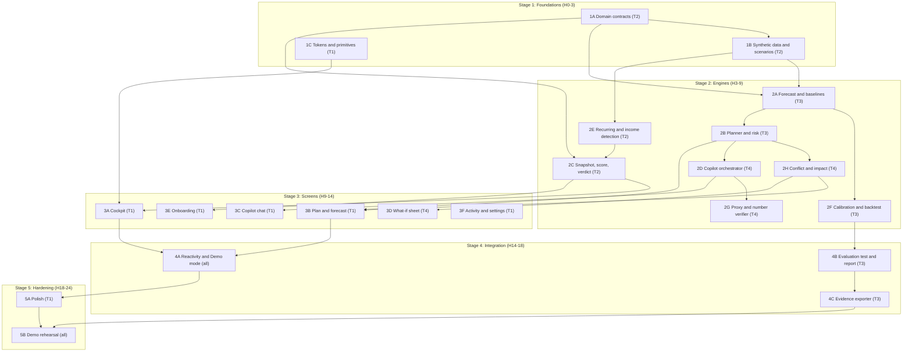

# 09 - Overall Plan (Master Implementation Plan)

**Project:** RupAI Financial Health Copilot
**Event:** HackMatrix 5.0 final round, problem statement FIN-02
**Team model:** four people, 24-hour sprint, native Kotlin and Jetpack Compose
**Merges and replaces:** `HACKATHON_PLAN_Main.md` and the FIN-02 multi-account addendum `new changes.md` (execution spine kept; method, product, security, ownership and the five-stream account layer folded in; see section 13). **Version 2.**

**Related docs:** [01 Product design](01-product-design.md) · [02 Pages](02-pages.md) · [03 Target audience](03-target-audience.md) · [04 Pain points](04-pain-points.md) · [05 Frontend UI style](05-frontend-ui-style.md) · [06 Backend](06-backend.md) · [07 UI/UX flow](07-ui-ux-flow.md) · [08 Tech stack](08-tech-stack.md)

---

## 1. Summary

We extend RupAI from an SMS expense tracker into a **Financial Health Copilot** that plans under uncertain cash flow. The judged core is two engines (a constrained action planner and a calibrated probabilistic forecaster) plus a reproducible evidence pack. Everything else (onboarding, cockpit, copilot chat) makes those engines understandable and trustworthy.

**Principles**
1. Engines in pure Kotlin, tested from the terminal. No emulator needed to verify the math.
2. Contracts first. Data classes are agreed in hour 0-3, so four people can work in parallel.
3. Numbers come from engines. The language model never calculates, and a verifier checks its text.
4. Every number in the pitch comes from a real run. No hand-typed benchmark values.
5. The demo must not fail: a local fallback exists for every cloud dependency.
6. One snapshot, five streams. Bank accounts, cards, loans, SIPs and payment history feed one `FinancialSnapshot` and one `ConsolidatedView`. There is one contract, not two.

## 2. Scope and priority

| Priority | Items |
|---|---|
| **Must** (scored directly) | Domain contracts including account, investment and consolidated-view models (1A) · synthetic multi-account data and scenarios (1B) · forecast with calibration and baselines (2A, 2F) · planner and risk (2B) · conflict resolver (2H) · snapshot, consolidated view, recurring and SIP detection and health score (2C, 2E) · Plan screen and Cockpit with the accounts row (3A, 3B) · reactivity and Demo mode (4A) · evaluation and evidence pack (4B, 4C) |
| **Should** | Copilot chat with verified narration (2D, 2G, 3C) · what-if sheet (3D) · onboarding and data-source flow (3E) |
| **Could** | Activity, settings and privacy center screens (3F) · real SMS path polish · CSV import · weekly-period demo · animations |

**Cut order if time runs short** (cut from the top of this list first): animations and polish → CSV import → weekly demo → accounts sheet M10 (keep the accounts row) → 3F → real SMS ingestion (use sample profiles) → proxy narration (use the local advisor) → 3E (use a sample profile preloaded).

## 3. Requirement traceability

### 3.1 Round additions and evidence (from the problem statement pages)

| Requirement | Delivered by | Phase | Verified by |
|---|---|---|---|
| Plan across at least six monthly (or eight weekly) periods using income, essential expenses, debt obligations and a declared minimum cash reserve | Planner with a period parameter; demo uses 6 monthly | 2B | `PlannerTest` |
| Compare at least two action sequences with cash balances and trade-offs by period | Plan A, Plan B and status quo, period tables | 2B, 3B | `PlannerTest`, Plan screen |
| Replan after a change in income or expenses | Repository recompute plus "what changed" | 2C, 4A | Reactivity test, demo |
| Identify conflicts and a proposed relaxation explicitly when constraints cannot all be met | Computed conflict and three relaxations (four when an SIP exists) | 2H, 3B | `ConflictResolverTest`, Scenario D |
| Forecast income and expenses with prediction ranges; declare horizon and method | Component bootstrap with calibrated 80% intervals; method string shown | 2A, 2F | `ForecastEngineTest`, Model report |
| Estimate cash-shortfall risk per action sequence and explain how risk changes the recommended plan | Monte Carlo risk per plan; selection rule with threshold θ; "Why this plan" line | 2B | `PlannerTest`, Scenario E |
| Compare with historical-average or recurring-payment forecasts on later held-out periods; report error, interval coverage and width | Rolling-origin evaluation, baselines with intervals | 2F, 4B | `ModelValidationBenchmarkTest` |
| Use public, existing or synthetic histories with variable income and recurring obligations; declare synthetic assumptions and separate generation periods | Three personas, 30 months, train / validation / test with separate seeds | 1B | `SyntheticDataSeederTest`, evidence README |
| Demonstrate stable income, income reduction, unexpected essential expense, infeasible target, and a case where uncertainty changes the preferred plan | Five scenarios, one tap each in Demo mode | 1B, 4A | Dry run |
| Submit period-level plans, constraints, forecasts, actual or simulated outcomes, a baseline comparison, and the train-validation-test timeline | Evidence pack | 4C | `ModelValidationBenchmarkTest` |

### 3.2 Core problem-statement outcomes

| Outcome | Delivered by | Phase |
|---|---|---|
| Consolidated financial-health view across bank accounts, cards, loans, investments and payment history | Snapshot, `ConsolidatedView`, Cockpit accounts row and accounts sheet (M1, M10) | 2C, 3A |
| Five streams handled as one picture without double counting | `Account`, `Investment`, `ConsolidatedView`; card, EMI and SIP parsers; two-view ledger rule for card bills | 1A, 1B, 2C, 2E, 3A |
| Identify spending patterns, recurring obligations, debt pressure, future cash-flow gaps | Detectors, forecast, obligations timeline | 2E, 2A, 3A |
| Conversational answers with personalised recommendations | Copilot orchestrator and chat | 2D, 3C |
| Expected impact of each recommended action | Impact simulator, what-if sheet | 2H, 3D |
| Separate observed facts, model predictions and recommendations, with confidence where information is incomplete | Observed / Predicted / Recommended tags, interval-derived confidence, completeness meter | 3A, 3C, 2F |
| Show how recommendations change as new data is added | Live recompute, Demo injectors, add-data flow | 4A |

## 4. Architecture in brief

Full detail in [06 Backend](06-backend.md) and [08 Tech stack](08-tech-stack.md).

```
Compose UI -> ViewModels -> FinancialHealthRepository (StateFlow<FinancialSnapshot>)
                                   │
        Room (encrypted) · Ingestion (SMS / CSV / manual / synthetic)
                                   │
   Pure-Kotlin engines: Forecast · Planner · Risk · Impact · Conflict · Evaluator · Evidence
                                   │
   Copilot orchestrator -> FastAPI proxy -> Gemini   (local fallback always available)
```

## 5. Team tracks and ownership

| Track | Person role | Owns (directories) | Phases |
|---|---|---|---|
| **T1 UI** | UI/UX specialist | `ui/**` (screens, components, theme, viewmodels, util), `domain/engine/HealthScore.kt` | 1C, HealthScore (Stage 2), 3A, 3B, 3C, 3E, 3F, 5A |
| **T2 Data** | Data and detection | `data/**` (except `data/remote/`), `domain/model/`, `domain/detect/`, `domain/engine/VerdictEngine.kt`, `ConsolidatedView.kt` | 1A, 1B, 2C, 2E, 4A (Demo mode data) |
| **T3 Math** | Forecasting and evaluation | `domain/engine/` forecast, baseline, planner, risk, evaluator and evidence files; `src/test/` for those | 2A, 2B, 2F, 4B, 4C |
| **T4 Copilot** | AI and actions | `domain/ai/`, `data/remote/`, `domain/engine/ConflictResolver.kt`, `ImpactSimulator.kt`, `ui/components/WhatIfSheet.kt`, `backend/` | 2D, 2G, 2H, 3D |
| **Integration Lead** (one of the four) | Shared files and merges | `app/build.gradle.kts`, `ui/navigation/NavGraph.kt`, `data/local/AppDatabase.kt`, `AppContainer` | Stage 4 wiring |

**Load balancing note.** Stage 2 is the heaviest. T3 holds forecast, calibration and planner. T4 takes the conflict resolver and impact simulator, T2 takes the verdict and the consolidated view, and T1, who has spare time in Stage 2 while the engines are built, takes the health score formula (a pure function with its own test), so no one carries more than three engines in the same stage.

### 5.1 Ownership rules
1. Never commit directly to `main`; work only on your own feature branch (`feat/track1-ui`, `feat/track2-data`, `feat/track3-math`, `feat/track4-copilot`).
2. Stay inside your directories. If you need something from another track, ask for it through the contract (the data classes in `domain/model/`).
3. Do not touch shared files (`build.gradle.kts`, `NavGraph.kt`, `AppDatabase.kt`, `AppContainer`) until Stage 4. The Integration Lead owns them. Phase 3D and any new screen register their routes through a short note to the Integration Lead rather than editing `NavGraph.kt`.
4. No `android.*` imports under `domain/engine/`, `domain/detect/`, `domain/model/` or `domain/ai/` logic files.

### 5.2 Merge order (hours 14-16)
```bash
git checkout main
git merge feat/track3-math      # engines, no UI or Android dependencies
git merge feat/track2-data      # models, seeder, detectors, repository
git merge feat/track4-copilot   # copilot, conflict, simulator, proxy client
git merge feat/track1-ui        # screens and components
# Integration Lead: wire NavGraph, AppContainer; then
./gradlew assembleDebug && ./gradlew test
```

## 6. Dependency graph



## 7. Phase specifications

Each phase lists owner, objective, files, dependencies, key steps, verification and definition of done. Algorithm details are in [06 Backend](06-backend.md); screen details in [02 Pages](02-pages.md) and [05 Frontend UI style](05-frontend-ui-style.md).

### Stage 1: Foundations (hours 0-3)

#### 1A. Domain contracts (T2)
- **Objective:** agree the data classes so all tracks can start.
- **Files:** `domain/model/PlanningModels.kt`, `ForecastModels.kt`, `AccountModels.kt`, `FinancialSnapshot.kt`, `CopilotModels.kt`.
- **Steps:** define `Txn`, `Liability`, `RecurringItem`, `DeclaredInputs`, `Goal`, `FinancialSnapshot`, `MonthlyAggregate`, `ProbabilisticForecast`, `PlanningPeriod`, `ActionSequence`, `GoalConflict`, `Relaxation`, `PeriodType`, `AccountType`, `Account`, `Investment`, `ConsolidatedView` per [06](06-backend.md), section 3.1. There is one `FinancialSnapshot`; the health score is computed, never stored in it, and the reserve comes from `DeclaredInputs`.
- **Do not build yet:** calculations, Room tables, UI.
- **Verification:** `./gradlew assembleDebug`
- **Done:** all files compile with no `android.*` imports; the Integration Lead announces the contract as frozen.

#### 1B. Synthetic data and scenarios (T2)
- **Objective:** generate reproducible histories and the five scenarios.
- **Files:** `data/ingest/SyntheticDataSeeder.kt`.
- **Steps:**
  1. Three personas (early earner, mid-career, committed) per [06](06-backend.md), section 12.2, each with its account set (bank, card, loans, SIP) per section 12.2a.
  2. 30 months: train 1-18, validation 19-24, test 25-30, each with its own seed stream, generated after models are frozen.
  3. Income processes (fixed, bonus months, lognormal AR(1) with late-payment slips), recurring payments with date jitter, lognormal variable spend with festival uplift, optional Poisson shocks.
  4. Five scenario overlays: stable, income reduction (to ₹55,000 from test month 2), emergency expense (₹25,000 in test month 3), infeasible target (₹1,00,000 target, ₹55,000 income, ₹40,000 reserve), high uncertainty (±40% volatility).
  5. Output as raw transactions (not a pre-labelled recurring list) so detection in 2E is genuine. Include card-use alerts, statement-generated alerts, bill payments, EMI debits and SIP debits; accounts and balances are derived from them.
  6. Add the persona B-sparse variant (missing car loan rate, card limit and minimum due) for the completeness demo, and calibrate persona B so its baseline monthly surplus is positive.
- **Verification:** `./gradlew test --tests "*SyntheticDataSeederTest"` (same seed gives identical output; windows do not overlap; 30 months generated; account balances reconcile with the ledger; persona B surplus is positive).
- **Done:** deterministic generation for all personas and scenarios.

#### 1C. Design tokens and primitives (T1)
- **Files:** `ui/theme/Color.kt`, `Type.kt`, `Shape.kt`, `Spacing.kt`, `Theme.kt`; `ui/components/TypeTag.kt`, `StatusPill.kt`, `MetricCard.kt`; `ui/util/IndianFormat.kt`.
- **Steps:** implement tokens from [05](05-frontend-ui-style.md); add `IndianFormatTest`.
- **Verification:** Compose previews render; `./gradlew test --tests "*IndianFormatTest"`.
- **Done:** tokens and primitives preview correctly in the light theme.

### Stage 2: Engines (hours 3-9)

#### 2A. Forecast engine and baselines (T3)
- **Files:** `domain/engine/ForecastEngine.kt`, `BaselineForecasts.kt`, `Stats.kt`.
- **Steps:** component bootstrap with 2,000 seeded paths; EWMA point forecasts; P10 / P50 / P90 per period; declared method string; historical-average baseline (with ±1.28σ interval) and recurring-payment baseline.
- **Verification:** `./gradlew test --tests "*ForecastEngineTest"` (P10 ≤ P50 ≤ P90; determinism with seed; under 100 ms).
- **Done:** forecasts for monthly and weekly periods.

#### 2F. Calibration and rolling backtest (T3)
- **Files:** `domain/engine/Calibrator.kt`, `Evaluator.kt`.
- **Steps:** learn the scaling factor `s` on the validation window ([06](06-backend.md), section 8.3); rolling-origin evaluation across personas and seeds; metrics (MAE, RMSE, coverage, width, pinball loss).
- **Verification:** `NoLeakageTest`, `CalibrationTest`.
- **Done:** coverage on validation within ±10 points of 80%; no-leakage test passes.

#### 2B. Planner and risk simulator (T3)
- **Files:** `domain/engine/PlannerEngine.kt`, `RiskSimulator.kt`.
- **Steps:** state-dependent policies (Plan A, Plan B, status quo) per [06](06-backend.md), section 9; period tables; interest amortisation and interest saved; Monte Carlo shortfall risk per plan; selection rule with threshold θ.
- **Verification:** `./gradlew test --tests "*PlannerTest"`.
- **Done:** at least two compared sequences, constraints respected, risk-based selection explained in a generated "why" string.

#### 2C. Snapshot, health score and verdict (T2)
- **Files:** `data/FinancialHealthRepository.kt`, `domain/engine/VerdictEngine.kt`, `ConsolidatedView.kt`. `HealthScore.kt` is written by T1 in Stage 2 and consumed here.
- **Steps:** build `FinancialSnapshot` from the ledger and declared inputs; build `ConsolidatedView` ([06](06-backend.md), section 7.4); completeness and missing list; health score (four components, [06](06-backend.md), section 7.3); 30-day verdict; `StateFlow` with mutation methods (`switchScenario`, `injectTransaction`, `updateDeclared`) that retrigger engines.
- **Verification:** `./gradlew test --tests "*FinancialHealthRepositoryTest"` and `"*ConsolidatedViewTest"`.
- **Done:** a scenario switch emits an updated snapshot, score and verdict immediately.

#### 2E. Recurring, income and liability detection (T2)
- **Files:** `domain/detect/RecurringDetector.kt`, `IncomeDetector.kt`, `LiabilityExtractor.kt`, `InvestmentDetector.kt`.
- **Steps:** algorithm per [06](06-backend.md), section 6; run on the synthetic transactions; ledger rules (transfers, card bills with the two-view rule, refunds, SIP debits); SIP detection ([06](06-backend.md), section 6.4).
- **Verification:** `./gradlew test --tests "*RecurringDetectorTest"` and `"*InvestmentDetectorTest"`.
- **Done:** detects rent, EMIs, SIPs and jittered utilities on all personas without false positives on variable spend.

#### 2D. Copilot orchestrator (T4)
- **Files:** `domain/ai/CopilotOrchestrator.kt`, `IntentRouter.kt`, `LocalAdvisor.kt`, `domain/model/CopilotModels.kt` (contract owned by T2; T4 proposes changes).
- **Steps:** intents (including `account_overview`) and `ResultBundle` with per-stream totals only ([06](06-backend.md), section 13); structured three-section response; local advisor with templates.
- **Verification:** `./gradlew test --tests "*CopilotOrchestratorTest"`.
- **Done:** every supported intent returns a non-empty three-section answer offline.

#### 2G. Proxy endpoints and number verifier (T4)
- **Files:** `backend/` (interpret and narrate endpoints, auth, limits), `data/remote/BackendClient.kt`, `domain/ai/NumberVerifier.kt`.
- **Steps:** endpoints per [06](06-backend.md), section 14; JWT verification; rate limit; verifier with template fallback; aggregates-only prompts.
- **Verification:** `./gradlew test --tests "*NumberVerifierTest"`; proxy tests.
- **Done:** a narration with an unverified number is replaced by the template.

#### 2H. Conflict resolver and impact simulator (T4)
- **Files:** `domain/engine/ConflictResolver.kt`, `ImpactSimulator.kt`.
- **Steps:** feasibility test; first violated period; three relaxations (lower target, extend timeline, reduce reserve by bisection) plus a fourth, reduce or pause the SIP by bisection, when an SIP exists, each with `riskAfter`; what-if simulator with common random numbers; runway, risk delta, interest saved.
- **Verification:** `./gradlew test --tests "*ConflictResolverTest"`.
- **Done:** Scenario D produces a computed conflict and relaxations; the simulator returns deltas under 200 ms.

### Stage 3: Screens (hours 9-14)

#### 3A. Cockpit (T1)
- **Files:** `ui/screens/CockpitScreen.kt`, `ui/components/VerdictCard.kt`, `HealthGauge.kt`, `ObligationTimeline.kt`, `CompletenessCard.kt`, `AccountsRow.kt`, `AccountsSheet.kt`, `ui/viewmodel/CockpitViewModel.kt`.
- **Steps:** verdict card, score gauge with component bars, timeline, 2×2 metric cards, alert banner; score explainer sheet; accounts row (four pills) and accounts overview sheet.
- **Verification:** emulator or device; scenario switch updates verdict and score.
- **Done:** matches [02 Pages](02-pages.md), M1 and M10.

#### 3B. Plan and forecast (T1)
- **Files:** `ui/screens/PlanScreen.kt`, `ui/components/ForecastFanChart.kt`, `PlanCard.kt`, `PeriodTable.kt`, `ConflictBanner.kt`, `ui/screens/ConflictScreen.kt`, `ModelReportScreen.kt`.
- **Steps:** period and plan switches; fan chart with table toggle; "Why this plan"; compare mode; conflict screen; report screen reading evaluation results.
- **Verification:** toggling plans updates chart, cards and table; Scenario D shows the conflict banner.
- **Done:** matches M2, M4, M7.

#### 3C. Copilot chat (T1)
- **Files:** `ui/screens/CopilotScreen.kt`, `ui/components/ThreeSectionAnswerCard.kt`, `SuggestionChips.kt`, `ui/viewmodel/CopilotViewModel.kt`.
- **Verification:** suggestion chips render three-section answers with tags, range and impact.
- **Done:** matches M5; offline fallback notice works.

#### 3D. What-if sheet (T4)
- **Files:** `ui/components/WhatIfSheet.kt`.
- **Steps:** sliders (including SIP change) and live before and after chips from `ImpactSimulator`; opens prefilled from Copilot recommendations.
- **Done:** matches M3.

#### 3E. Onboarding (T1 with T2)
- **Files:** `ui/screens/onboarding/*`, `OnboardingViewModel.kt`, `IngestViewModel.kt`.
- **Steps:** O1-O6; sample profile path first, then SMS and CSV.
- **Done:** a new user reaches a verdict in under three minutes on a sample profile.

#### 3F. Activity, settings, privacy (T1, could-have)
- **Files:** `ui/screens/ActivityScreen.kt`, `SettingsScreen.kt`, `PrivacyScreen.kt`, `DemoScreen.kt` (UI of S3).
- **Done:** matches M6, S1, S2, S3.

### Stage 4: Integration and evidence (hours 14-18)

#### 4A. Reactivity and Demo mode (all)
- **Steps:** Integration Lead wires `NavGraph.kt` and `AppContainer`; Demo mode panel with five scenario chips and injectors (surprise bill, bonus income, new recurring payment, pause SIP); verify live recompute and the "what changed" summary.
- **Verification:** tap "surprise bill": verdict, score, forecast and Copilot all update; Copilot cites the new expense.
- **Done:** reactivity demonstrated end to end.

#### 4B. Evaluation test and report (T3)
- **Files:** `src/test/.../ModelValidationBenchmarkTest.kt`.
- **Steps:** run the rolling-origin evaluation for all personas and several seeds; print an ASCII table; write `benchmark_results.json`.
- **Verification:** `./gradlew test --tests "*ModelValidationBenchmarkTest*"`
- **Done:** a terminal run prints real metrics for our model and both baselines.

#### 4C. Evidence exporter (T3)
- **Files:** `domain/engine/EvidenceExporter.kt`.
- **Steps:** write the pack in [06](06-backend.md), section 17; share button on the report screen.
- **Done:** all required submission items present in `build/evidence/`.

### Stage 5: Hardening and demo (hours 18-24)

#### 5A. Polish (T1)
Entry animations (sparingly), skeletons, Indian formatting everywhere, light-theme check, no truncation, TalkBack summaries for charts, contrast verification.

#### 5B. Demo rehearsal (all)
Timed three-minute dry runs ([07](07-ui-ux-flow.md), section 4); backup screen recording; offline test with airplane mode; one warm proxy instance. **Code freeze at hour 22.**

## 8. Schedule

| Hours | Focus |
|---|---|
| 0-1 | Repo and branches; agree contracts (1A) |
| 1-3 | 1B seeder, 1C tokens |
| 3-9 | Engines: 2A, 2F, 2B, 2C, 2E, 2D, 2G, 2H |
| 9-14 | Screens: 3A, 3B, 3C, 3D, 3E |
| 14-16 | Merge in order; wire navigation; `assembleDebug` and `test` |
| 16-18 | 4A, 4B, 4C |
| 18-22 | 5A polish, fixes, 3F if time |
| 22-24 | Code freeze, rehearsal, evidence pack check |

## 9. Demo plan

Timed script and screen mapping are in [07 UI/UX flow](07-ui-ux-flow.md), section 4. The five scenarios and what each must show are in [06 Backend](06-backend.md), section 12.3. Rules for the live demo:
- Use synthetic personas; no real data on screen.
- Every figure quoted comes from the latest run of `ModelValidationBenchmarkTest`; do not quote numbers from earlier drafts.
- Show the terminal for ten seconds: command, table, evidence folder.
- If a cloud call fails, the local advisor answers and the demo continues.

## 10. Verification checklist (final)

- [ ] `./gradlew assembleDebug` succeeds.
- [ ] `./gradlew test` passes, including `NoLeakageTest`, `CalibrationTest`, `PlannerTest`, `ConflictResolverTest`.
- [ ] `ModelValidationBenchmarkTest` prints real metrics and writes the evidence pack.
- [ ] Evidence pack contains period-level plans, constraints, forecasts, outcomes, baselines, timeline and assumptions.
- [ ] Five scenarios reproducible in one tap each.
- [ ] Scenario E shows the preferred plan changing because of risk, with the rule stated.
- [ ] Scenario D shows a computed conflict and three relaxations (four when an SIP exists).
- [ ] The accounts row shows bank cash, card dues, loan EMIs and SIP for persona B, matching `ConsolidatedViewTest`.
- [ ] The card bill is counted once in the cash forecast, on its due date.
- [ ] No institution name or account digits appear in any Copilot prompt or proxy request (check the transmission log).
- [ ] Copilot answers carry Observed, Predicted and Recommended sections; offline fallback works.
- [ ] No hand-typed benchmark numbers anywhere (app, slides, docs).
- [ ] Airplane-mode run of the demo succeeds.

## 11. Risk register

| Risk | Likelihood | Impact | Mitigation | Owner |
|---|---|---|---|---|
| Calibration does not reach near-nominal coverage | Medium | High | Larger calibration set; report honestly; show coverage by horizon | T3 |
| Stage 2 overruns | High | High | Contract-first; cut order in section 2; T3 load relieved | All |
| Merge conflicts at integration | Medium | Medium | Directory ownership; fixed merge order; shared files by one person | Integration Lead |
| Gemini quota or network failure | Medium | Medium | Local advisor; number verifier; warm proxy | T4 |
| Recurring detector false positives | Medium | Medium | Confidence threshold; confirm or dismiss in UI; tests on all personas | T2 |
| Evaluation numbers look unfavourable | Medium | Medium | Do not tune on test window; explain shocks; coverage and honesty over polish | T3 |
| UI not ready for the demo | Medium | High | Table fallback for charts; Plan and Cockpit first; polish last | T1 |
| Privacy claim overstated | Low | High | Claim only what the architecture does; privacy center shows the real log | T4 |
| Device or emulator problems | Medium | Medium | Engines tested on the JVM; physical device and screen recording ready | All |
| Multi-account scope creep (a parser for every stream and bank) | Medium | Medium | Synthetic and sample profiles first; real parsers only for card, EMI and SIP templates of two or three banks; cut order in section 2 | T2 |
| SIP and rent make scenarios B and D so negative that plans look identical | Medium | Medium | Persona B calibration in 1B; hour-8 check ([06](06-backend.md), 12.3); raise the reduced income if needed and document it | T2, T3 |

## 12. Definition of done (project)

1. All **Must** items work on a physical phone and from the terminal.
2. The five required demonstrations run in under three minutes.
3. The evidence pack is exportable and matches the problem statement list.
4. Privacy and security controls in [06](06-backend.md), section 15, are in place or explicitly marked as not yet implemented in the pitch.
5. Documentation (this folder) matches what was built; deviations are noted in a short "What changed" section at the end of this file.

## 13. Changes from `HACKATHON_PLAN_Main.md`

| Area | Original | Now |
|---|---|---|
| Synthetic timeline | 5 training months, 1 validation (unused), 6 test | 30 months in three separately seeded windows; validation window used for calibration |
| Forecast | Bootstrap of discretionary variance, uncalibrated | All components, conformally calibrated 80% intervals, rolling-origin backtest across personas and seeds, baselines given intervals |
| Benchmark table | Illustrative figures printed in the plan and pitch | Real run only; example values removed |
| Planner | Two hand-coded sequences, hardcoded conflict text | Parametric state-dependent policies, status-quo baseline, risk-based selection rule, computed relaxations by bisection |
| Recurring and debt detection | Claimed but not built | Phase 2E, run on raw synthetic transactions |
| Health score | Black box | Four explainable components with a breakdown sheet |
| Confidence | Unexplained `confidenceScore` | Derived from interval width and history length |
| Copilot | Gemini called from the app, snapshot in prompt | Intent allow-list, proxy, aggregates-only prompts, number verifier, local fallback |
| Evidence | `benchmark_results.json` only | Full pack: plans, constraints, forecasts, outcomes, baselines, timeline, assumptions |
| Product layer | Demo-oriented screens | Onboarding, verdict-first Cockpit, completeness meter, explainers, privacy center, hidden Demo mode |
| Visuals | Prediction in amber; all-caps tags | Prediction in blue; sentence-case tags (Observed, Predicted, Recommended) |
| Security | Not covered | Hashed counterparties, encrypted local DB, Keystore, consent toggles, transmission log |
| Ownership conflicts | Track 4 edited `NavGraph.kt`; copilot engine in `data/`; viewmodels outside any track directory | `NavGraph.kt` only by the Integration Lead; copilot logic in `domain/ai/`; viewmodels under T1; load rebalanced |
| Phases | 16 | Adds 2C (extended), 2E, 2F, 2G, 2H, 3E, 3F, 4C |
| Multi-account layer (from `new changes.md`) | Separate addendum: its own flat `FinancialSnapshot` with a stored score and hard-coded ₹25,000 reserve; `FinancialAccount` inside `PlanningModels.kt`; 6-month seed; emoji pills; `GeminiCopilotEngine` in `data/`; "500-run" Monte Carlo; institution names and masked digits in the Copilot lane | Folded in: one snapshot contract; `AccountModels.kt`; 30-month seed with generated account sets; Material icons; copilot logic in `domain/ai/`; 2,000 paths; institution names and digits stay on the device; reserve from declared inputs |
| Investments | A SIP stream with "wealth accumulation rate" | SIP detection only, treated as committed savings, never a portfolio value; no investment advice |
| Card dues | A single "dues" figure | Two-view ledger rule: spending at card use, cash at bill payment, never both |

## 14. Running a phase with the Android Studio agent

Send this to the agent, replacing `[ID]` with the phase ID (for example `2B`):

```
Implement Phase [ID] from docs/09-overall-plan.md only.

Before editing or creating any files:
1. Run `git branch --show-current` and confirm I am on my own feature branch
   (feat/track1-ui, feat/track2-data, feat/track3-math or feat/track4-copilot). Never work on main.
2. Read the Phase [ID] section, plus the linked sections of docs/06-backend.md
   (and docs/05-frontend-ui-style.md or docs/02-pages.md for UI phases).
3. Show me your plan, the files you will create or modify (inside my directories only),
   any database changes, and any commands you will run.
4. Wait for my approval before changing anything.

After approval:
- Implement only Phase [ID]. Do not build later phases.
- Do not change the stack or architecture described in docs/08-tech-stack.md.
- Keep domain/engine, domain/detect, domain/model free of android.* imports.
- Do not edit shared files (build.gradle.kts, NavGraph.kt, AppDatabase.kt, AppContainer).
- Never type benchmark or metric numbers by hand; compute them.
- If something from an earlier phase is missing or broken, stop and tell me.

When finished:
1. Summarise what changed and list every file created or modified.
2. Say what was intentionally not implemented because it belongs to a later phase.
3. Give me the exact verification command for Phase [ID].
4. Do not move to the next phase until I confirm this one works.
```

## 15. Open items to settle in the first hour

1. Who is the Integration Lead (recommendation: T4, see section 16.8).
2. Confirm the contract (1A) and freeze it.
3. Gemini model and quota for the event; confirm the local fallback path.
4. Shortfall-risk thresholds per cohort (defaults in [06](06-backend.md), section 9.4).
5. Final health-score constants (defaults in [06](06-backend.md), section 7.3).

## 16. Team of four: how to work

This section turns the tracks in section 5 into a working routine. The idea: **agree contracts first, build against fixtures, merge on a clock.**

### 16.1 Roles at a glance

| Track | Mission in one line | Works against | Is never blocked because |
|---|---|---|---|
| **T1 UI** | Make the verdict, the plan and the accounts row understandable | Fixture `UiState` objects until real engines land | Compose previews run on fixtures; `HealthScore` is a pure function of the frozen snapshot |
| **T2 Data** | Turn raw transactions into one trustworthy snapshot | The frozen contract in `domain/model/` | The contract is agreed in hour 0-1; the seeder needs no engine |
| **T3 Math** | Forecast, calibrate, plan and prove it | Plain arrays and a small in-test generator until the seeder lands | `Stats.kt` and the bootstrap need only `DoubleArray` |
| **T4 Copilot** | Questions in, verified answers out; conflicts and what-ifs | Fixture `ResultBundle`s and stub engine signatures | The proxy and verifier are independent of the engines |

### 16.2 Rhythm: six ten-minute stand-ups

| Hour | Stand-up | Decision or output |
|---|---|---|
| 0 | Kick-off | Pick the Integration Lead; walk through [06](06-backend.md) section 3.1; create the four branches |
| 1 | Contract freeze | Freeze `domain/model/` including `AccountModels.kt`. After this, changes go through the contract protocol (16.5) |
| 3 | Foundations done | Seeder output shared; T3 publishes `PlannerEngine` and `RiskSimulator` signatures (empty bodies); T1 tokens ready |
| 9 | Engines demo from the terminal | Each engine shown running under `./gradlew test`; go or no-go on the cut order |
| 14 | Merge window opens | Merge in the order in section 5.2; the Integration Lead wires `NavGraph.kt` and `AppContainer` |
| 18 | Scope freeze | No new features; only fixes and polish. Code freeze at hour 22 |

### 16.3 Per-person plan

| Hours | T1 UI | T2 Data | T3 Math | T4 Copilot |
|---|---|---|---|---|
| 0-3 | Tokens, `IndianFormat`, `TypeTag`, `StatusPill`, `MetricCard`, `AccountsRow` on fixtures | Contract with `AccountModels.kt`; seeder with account sets | `Stats.kt`; bootstrap and quantiles with tests on arrays | Proxy skeleton, Pydantic models, JWT check; intent list and templates on fixture bundles |
| 3-9 | `HealthScore.kt` plus test; Cockpit, Plan and Copilot screens on fixtures; fan chart with fake bands | Recurring, income, liability and SIP detectors; repository; `ConsolidatedView`; verdict | Forecast, calibration, backtest, planner, risk | Orchestrator, number verifier, conflict resolver, impact simulator (against T3's signatures) |
| 9-14 | Replace fixtures with real ViewModels as engines land; accounts sheet; onboarding | Onboarding ingest flow; Demo mode data and injectors; real SMS parsers if time | Evaluator, benchmark test, evidence exporter | `WhatIfSheet`; `BackendClient`; warm proxy deployed |
| 14-18 | Fix integration issues on screens; Model report screen | Reactivity and the "What changed" summary | Run the benchmark; write the evidence README | Integration Lead: merge, wire navigation, `assembleDebug` and `test` |
| 18-22 | Polish, TalkBack summaries, contrast, light-theme consistency | Demo scenario dry runs; fix data bugs | Check every quoted number against the latest run | Offline and airplane-mode test; fallback paths |
| 22-24 | Rehearse | Rehearse | Rehearse; evidence pack check | Rehearse; screen recording backup |

### 16.4 Handoffs: who gives what to whom

| From | To | What | By hour |
|---|---|---|---|
| T2 | Everyone | Frozen `domain/model/` | 1 |
| T2 | T3 | Persona B seeded transactions (CSV or function) | 3 |
| T3 | T4 | `PlannerEngine` and `RiskSimulator` signatures | 3 |
| T3 | T1 | `ProbabilisticForecast` and `ActionSequence` sample JSON for chart fixtures | 3 |
| T2 | T1 | `FinancialSnapshot` and `ConsolidatedView` sample JSON | 3 |
| T4 | T1 | `ResultBundle` and `StructuredResponse` sample JSON | 3 |
| T3 | T2, T4 | Working forecast and planner | 9 |
| T2 | T1, T4 | Repository `StateFlow` with `switchScenario` and `injectTransaction` | 9 |

### 16.5 Working agreement

1. **Branches.** One branch per track. Nobody commits to `main`. Rebase on `main` after each merge window.
2. **Own your directories.** If you need something from another track, ask for it through the contract, not by editing their files.
3. **Contract changes.** Post the change in the group chat, get a thumbs-up from the owners of the consumers, then T2 edits `domain/model/`. Never edit another track's data classes silently.
4. **Shared files.** Only the Integration Lead touches `build.gradle.kts`, `NavGraph.kt`, `AppDatabase.kt` and `AppContainer`. Others send a two-line note.
5. **Definition of done for a task.** Compiles, its named test passes from the terminal, no `android.*` in engine, detect or model code, no hand-typed numbers.
6. **Blocked for more than 20 minutes.** Say so in the chat, switch to a fixture, and keep going. Do not wait.
7. **Use the agent prompt in section 14** for each phase, so every phase starts with a plan you approve.
8. **Privacy check before every merge.** Institution names and account digits appear nowhere in prompts or proxy requests.

### 16.6 Pairing and review

- **Math review:** T3 explains calibration and the planner policies to T4 in a ten-minute walk-through at hour 9, since T4 builds on them.
- **Contract review:** T1 and T4 read T2's model files at hour 1 and challenge anything they cannot render or narrate.
- **Demo review:** all four run the three-minute script ([07](07-ui-ux-flow.md), section 4) twice before the freeze.

### 16.7 If you fall behind

Follow the cut order in section 2. The rule of thumb: protect the engines, the Cockpit verdict, the Plan screen and the evidence pack. Keep the accounts row; drop the accounts sheet first. Never cut the local fallbacks.

### 16.8 Recommended Integration Lead

**T4.** T4 is lightly loaded in Stage 3 (only the what-if sheet), which is exactly when merges and navigation wiring happen, and the proxy work is isolated from everyone else. **T2** acts as contract steward, because T2 owns `domain/model/` and the repository.
