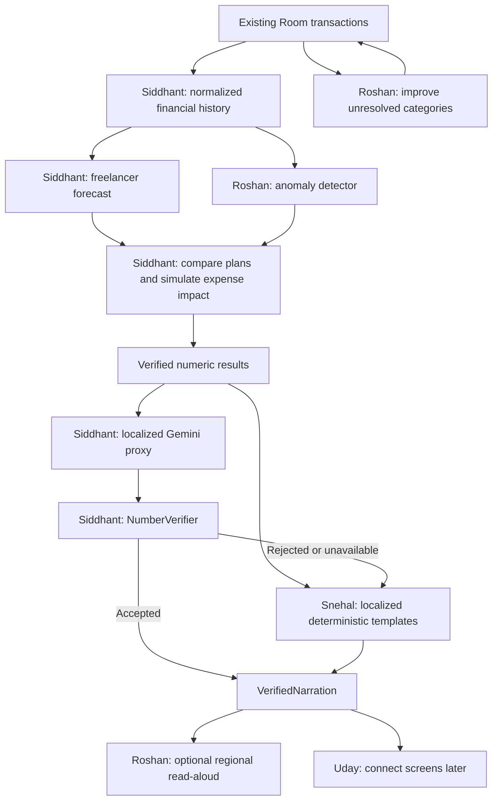

# RupAI Sprint 2: Three-Person Parallel Implementation Plan

**Date:** October 11, 2026 (IST)
**Team:** Siddhant (Financial Intelligence & Integration), Roshan (Transaction Intelligence & Audio), Snehal (Localization & Quality Assurance)
**UI owner:** Uday, outside this sprint's implementation ownership
**Task checklist:** [todo.md](todo.md)
**Status:** Siddhant's Phases 1A-4A are verified headlessly. Phase 4A uses injected translation fixtures; real localization integration, remaining phases and team-wide setup confirmations are pending.

Phase 5A headless core is now implemented and verified (114 JVM tests / Kotlin compile). Final cross-track acceptance remains open: refreshed Snehal localization has incompatible snapshot/response contracts, Roshan anomaly/audio modules are not yet present, and full backend discovery exposes four unchanged categorizer failures. See [Phase 5A results](review/phase5a-results.md).

## 1. Objective and Scope

Extend the existing app with irregular-income planning for freelancers, unusual-expense alerts, reliable categorization, regional-script explanations, and optional read-aloud of the final verified answer. Deliver headless services and tested contracts without changing screens.

Speech means text-to-speech AFTER verification. It does not mean microphone input, a wake word, continuous listening, or a second AI financial assistant.

Reference specifications remain `md files/09-overall-plan.md` and `md files/06-backend.md`, especially forecasting, constraints, simulation, proxy narration and evaluation. This is a supplementary sprint, not a replacement for today's trackers or completed phases.

## 2. Current State: Reuse Before Building

- Current inspected checkout: `Siddhant`. Existing Copilot models, LocalAdvisor, NumberVerifier, BackendClient, ImpactSimulator and ConflictResolver are available.
- `origin/Roshan` contains ForecastEngine, PlannerEngine, RiskSimulator, Calibrator, Evaluator, baselines and evaluation tests. These are candidate reuse sources, not automatically integrated or verified modules on this checkout.
- `origin/Snehal` contains detectors, FinancialHealthRepository and snapshot/account models. Inspect and reuse appropriate code rather than recreating the whole data layer.
- IMPORTANT: the Roshan engine source references snapshot properties such as `planningPeriods`, `currentBalance` and `activeScenario`, whereas Snehal's snapshot exposes `cash`, `history` and `declared`. A blind branch merge will not resolve this contract mismatch.
- The tracked categorizer still has old merchant truncation/cache/worker behavior. An untracked `backend/test_categorizer.py` already exists; inspect and preserve it. Do not replace it or assume it passes.
- Current Insights uses the older direct GeminiAdvisor path. The new verified Copilot path exists separately. Uday connects UI later; nobody in this sprint claims the current Insights screen has been migrated.
- The credit-card two-view ledger is not established by the current SMS entity. Category fixes alone cannot solve consumption-versus-cash double-counting.

Source discovery used the code graph plus direct source reads and read-only branch inspection. The Android subtree is excluded from the graph index; branch files and source reads take precedence over graph metadata.

## 3. Parallelism Rules

1. All three start at the same time after a short contract discussion; no one waits for another person's feature implementation.
2. Each track uses its own small fixtures or injected input values. New feature packages must not import another teammate's unfinished module during Stages 1-4.
3. Existing `CopilotModels.kt`, ImpactSimulator and ConflictResolver are read-only dependencies for Roshan and Snehal. Siddhant owns any compatible extension.
4. New track-specific inputs are narrow boundary DTOs, not competing full FinancialSnapshot classes. Siddhant writes the adapters at final integration.
5. Shared integration necessarily depends on completed outputs. We remove development blockers, not pretend there are zero integration dependencies.
6. Work in separate local clones or existing separate worktrees. Three processes must not switch branches inside one shared working directory. No new worktree/branch is created by this document.
7. Commit one verified phase at a time. Only the owner edits their implementation and tests. Ask the owner for a cross-track fix instead of editing their file concurrently.
8. `tasks/plan.md` and `tasks/todo.md` have one editor: Siddhant. Teammates report phase results; they do not all edit the central checklist simultaneously.

## 4. Ownership and Responsibilities

Android paths below are relative to `android_app/app/src/main/java/com/example/financeapp/`. JVM test paths mirror the feature packages under `android_app/app/src/test/java/com/example/financeapp/`.

| Person | Responsibility | Exclusive implementation ownership |
|---|---|---|
| Siddhant | Forecast correctness, financial normalization, engine interoperability, multilingual proxy/verifier, final headless integration | New `domain/freelancer/`, `data/planning/`; existing `domain/ai/NumberVerifier.kt`, `domain/ai/CopilotOrchestrator.kt`, `data/remote/BackendClient.kt`, `backend/copilot.py`; narrowly selected engine/model reconciliation |
| Roshan | Categorization reliability, anomaly detector, read-aloud service | Existing `data/SmsParser.kt`, `BackendCategorizerClient.kt`, `AiCategorizationWorker.kt`, `TransactionViewModel.kt`, `TransactionDao.kt`, `VpaResolver.kt`; `backend/categorizer.py`, `backend/cache.py`; new `domain/anomaly/`, `data/audio/` |
| Snehal | Language catalogue, deterministic translations, fixture curation, human review and demo documentation | New `domain/ai/localization/`, matching tests/resources; `tasks/fixtures/`, `tasks/review/`, `tasks/UI_HANDOFF.md` |

All corresponding tests belong to the implementation owner. Existing cloud categorization tests belong to Roshan; Copilot proxy tests belong to Siddhant. No one edits all of `backend/` indiscriminately.

Reserved for Uday: all `ui/`, NavGraph, screen ViewModels and visual components. Shared `build.gradle.kts`, version catalogues, manifest, Room entity/schema migrations, app entry point and dependency container are frozen unless their owner explicitly coordinates a change. No new dependency is assumed for the MVP.

## 5. Frozen Handoff Contracts

These are proposed v1 boundary agreements, not instructions to create a large universal models file. Freeze field names and examples at Phase 0. Existing ResultBundle and StructuredResponse remain backward-compatible.

### Finance input and result: Siddhant

- History: chronologically ordered monthly income, essentials, debt service, discretionary spend and SIP; zero-income months are retained. Unknown/unreconciled records carry a data-quality reason.
- Declared inputs: current bank cash with an as-of time, reserve, obligations, loan rates/balances, risk threshold and optional savings goal. No fabricated bank balance from SMS net totals.
- Forecast output: monthly periods, P10/P50/P90, seeded component paths, method name, history size and limitations. Horizon: six MONTHLY periods for the MVP.
- Decision output: period tables for Plan A, Plan B and status quo; absolute risk per plan, selected plan/reason, optional conflict/relaxations and ResultBundle adapter.
- Data-quality failures return an explicit unavailable/insufficient-data outcome, not made-up risk or forced zero values.

### Anomaly contract: Roshan

Proposed call: `detect(candidate: ExpenseObservation, prior: List<ExpenseObservation>, asOf: Instant): AnomalyAssessment`.

- Input fields: id, timestamp, positive expense amount in INR, canonical category, local merchant key, recurring/expected flag and event kind (`EXPENSE`, `TRANSFER`, `SETTLEMENT`, `UNKNOWN`). No raw SMS is required.
- Output fields: transactionId, status (`NORMAL`, `UNUSUAL`, `INSUFFICIENT_HISTORY`, `NOT_APPLICABLE`), reason code, comparison amount, history count and method version.
- Thresholds are detector-owned and validation-tuned; a score is not a probability of fraud. The detector does not call ForecastEngine, Room or Gemini.
- Absolute reserve-impact severity is computed separately by Siddhant. Roshan never needs to wait for that simulator adapter.

### Language contract: Snehal

- `NarrationLanguage`: `ENGLISH`, `HINGLISH`, `HINDI`, `MARATHI`.
- API codes: `en`, `hi-Latn`, `hi-Deva`, `mr-Deva`. Speech locales: `en-IN`, `hi-IN`, `hi-IN`, `mr-IN` respectively.
- Proposed call: `LocalizedAdvisor.advise(intent: CopilotIntent, bundle: ResultBundle, language: NarrationLanguage): StructuredResponse`.
- Preserve observed refs, prediction range, horizon, confidence, action impact, intent and LOCAL source. Translate only text fields, including trade-off text.
- Keep ASCII digits, INR labels and `%` in all scripts initially. Do not express new numeric amounts as words or local abbreviations that bypass verification.
- Language choice lives outside existing StructuredResponse for compatibility: `VerifiedNarration(response, languageCode, speechLocale, provenance)` is a proposed Siddhant-owned integration result.

### Speech contract: Roshan

Proposed API: `initialize()`, `speak(verifiedText: String, localeTag: String)`, `stop()`, `close()` and an observable readiness/error state.

- Accept a locale string, not Snehal's unfinished enum. A fake speech engine can exercise the contract without her module.
- The final pipeline is the only production caller and supplies already verified text. Speech does not call Gemini, translate, infer financial actions or bypass verification.
- Missing language data/unsupported locale is explicit. The service never silently speaks Marathi text with an unrelated voice and never starts speaking automatically.
- Android framework usage is allowed only in `data/audio/`, never `domain/`.

## 6. Overall Workflow



This is the target integration, not a claim that these connections already exist. Category updates trigger one new financial snapshot revision, not a second transaction ingestion path.

## 7. Phase 0: Agree and Start Together (20-40 Minutes)

**Owner:** Siddhant coordinates; everyone participates briefly.
**Files:** planning documents only. **Dependencies:** None. **Scope:** Small.

- [ ] Freeze the contracts above and record one synthetic input/output example for each boundary.
- [ ] Confirm separate checkouts, ownership and the exact submission deadline; inspect candidate reuse commits without overwriting existing work.
- [ ] Record baseline compile/test failures and choose the snapshot integration approach. Do not import both incompatible FinancialSnapshot definitions.

**Verification:** inspect paths and signatures on each branch; run baseline compilation and available focused suites in each isolated checkout. Existing failures are recorded, never suppressed. **Done:** everyone knows their first phase and can test against local fixtures.

## 8. Stage 1: Independent Foundations

### Phase 1A - Financial History Boundary (Siddhant)

**Goal:** produce trustworthy monthly inputs without changing Room or UI.
**Files:** `domain/freelancer/FreelancerModels.kt`, `FinancialHistoryNormalizer.kt`; `FinancialHistoryNormalizerTest.kt`.
**Dependencies:** Phase 0 only. **Estimate:** 2-3 hours. **Scope:** Medium.

- [x] Preserve zero-income months, canonicalize categories, exclude known transfers/refunds from earned income, and keep consumption separate from cash settlements.
- [x] Handle cash anchors, essentials, debts and SIP exactly once. Do not count profile salary plus the same received salary again; flag unknown event types instead of guessing.
- [x] Cover card swipe plus settlement, duplicate event identity, partial current month, zero-income month and missing balance. Unknown real-data ledger cases gate forecast readiness; synthetic typed fixtures remain usable.

**Verification:** JVM `*FinancialHistoryNormalizerTest*`. **Done:** deterministic normalized history or an explicit data-quality outcome.

**October 11 implementation record:** 16 focused cases pass as part of all 36 JVM tests; production Kotlin compilation succeeds. New files only under `domain/freelancer/` and its JVM tests; no production caller, Room, UI, API or shared build file changed.

**Implemented boundary:** `normalize(events, historyStart, asOf, cashAnchor)` returns `HistoryNormalization.Ready` or `Unavailable` with fixed reason codes. Inputs use positive integer INR paise, explicit event kind/funding/expense class and a local economic-event id. The caller declares complete coverage from historyStart; empty covered months become zero months, not inferred missing-data fixes. The current partial month is excluded from training history. CashAnchor must represent bank cash at the supplied asOf; older anchors must be reconciled upstream, not silently accepted.

**Safety and integration limits:** No raw SMS/account fields, network calls, logs or keys in this boundary. Input count/history/field sizes are bounded and arithmetic is overflow-checked. Refunds are separate from earned income and gross consumption. Card settlements are included in cashDebtServicePaise, never added again as consumption. Duplicate ids count once; conflicting duplicates fail closed. Different SMS ids for the same economic event still require upstream reconciliation. Declared salary is deliberately not an input and cannot be added twice. Existing Room rows lack these typed ledger distinctions, so no automatic Room adapter is claimed. Final integration must use cash fields for liquidity and consumption fields for spending, not sum both views.

**AI/security configuration observed, not live-verified:** The planned freelancer forecast is local history-based block bootstrap/Monte Carlo, requiring no API key and making no neural-model-training claim. Current backend narration reads server environment `GEMINI_API_KEY` and `COPILOT_GEMINI_MODEL` (default `gemini-1.5-flash`); categorization currently configures `gemini-2.0-flash` and optionally uses `PLACES_API_KEY`. Model availability/quota has not been tested. The legacy Android GeminiAdvisor reads `BuildConfig.GEMINI_API_KEY`, which embeds a provider credential in the APK when configured. That existing path remains unchanged here; migration to server-held credentials needs coordinated integration before release.

### Phase 1B - Android Categorization Reliability (Roshan)

**Goal:** fix the client/parser/worker failure paths, not force unknown payments into categories.
**Files:** `data/SmsParser.kt`, `BackendCategorizerClient.kt`, `AiCategorizationWorker.kt`; `SmsParserTest.kt`, `CategorizationPolicyTest.kt`.
**Dependencies:** Phase 0 only; backend responses are fixtures. **Estimate:** 2-3 hours. **Scope:** Medium.

- [ ] Preserve business-name clues and fix keyword priority/boundaries; Medical Store is Health and Steam is not Food.
- [ ] Deduplicate and bound requests within the server limit and realistic timeouts; validate category/source and stop caching transient FALLBACK as permanent success.
- [ ] Persist successful small batches incrementally; partial/missing results stay pending and cancellation propagates. Preserve manual choices; do not automatically reset ambiguous historical processed flags.

**Verification:** JVM `*SmsParserTest*` and `*CategorizationPolicyTest*`; compile production Kotlin. **Done:** offline policy regressions pass before a live provider is required.

### Phase 1C - Language Catalogue and Examples (Snehal)

**Goal:** establish the four supported output modes without touching networking or verifier logic.
**Files:** `domain/ai/localization/NarrationLanguage.kt`; `NarrationLanguageTest.kt`; `tasks/review/language-examples.md`.
**Dependencies:** Phase 0 and existing CopilotModels only. **Estimate:** 1-2 hours. **Scope:** Small.

- [ ] Define the four language codes, script labels and speech locales from the frozen contract.
- [ ] Write human-readable examples for cash overview, low income, unusual expense and reserve warning, using synthetic values.
- [ ] Test locale mapping and unsupported-code handling; keep English behavior backward-compatible.

**Verification:** JVM `*NarrationLanguageTest*` and manual example review. **Done:** language choices require no code from Roshan or Siddhant's new modules.

### Checkpoint 1

Each owner runs their own suite, publishes a phase commit and records known limitations. Nobody waits for another track to finish Stage 1 before continuing their own Stage 2.

## 9. Stage 2: Independent Feature Slices

### Phase 2A - Irregular Income Forecast (Siddhant)

**Goal:** replace arbitrary scenario noise with history-derived freelancer uncertainty.
**Files:** `domain/freelancer/FreelancerForecaster.kt`, `ForecastPathAdapter.kt`; `FreelancerForecasterTest.kt`, `ForecastPathAdapterTest.kt`.
**Dependencies:** 1A only. **Estimate:** 3-4 hours. **Scope:** Medium.

- [x] Reuse verified Stats/bootstrap helpers where compatible; use the documented block bootstrap (length two), seeded 2,000 paths and six monthly periods. Keep zero receipts and irregular timing in the history.
- [x] Produce ordered percentiles and reproducible component paths; explicitly return insufficient-history limitations rather than injecting undocumented sample incomes.
- [x] Model one-month payment delay using a conservative typed scenario; shift rather than duplicate the receipt. Preserve debt/essential/SIP commitments in paths and match existing SimulationInputs units.

**Verification:** JVM `*FreelancerForecasterTest*` and `*ForecastPathAdapterTest*`; same seed gives identical paths, no negative receipt samples, no future records used. **Done:** simulator-ready monthly input from standalone history fixtures. Explicit invoice tracking is deferred.

**Completed October 11:** 20 focused cases; full JVM suite 56/56 and production Kotlin compilation passed. No Android imports, network calls, new dependencies, shared-engine edits or UI changes. Compatible SimulationInputs/CashFlowPeriod are reused; Roshan's branch-only Stats was inspected but not imported because it is absent here and its interpolated quantiles may produce fractional paise. Local nearest-rank quantiles retain integer paise.

**Temporal/data contract:** six rolling monthly intervals begin exactly at the cash anchor, not the next calendar month. Require 6-120 consecutive completed history months ending immediately before the anchor month. Caller supplies future essentials/debt/SIP for those rolling intervals; historical commitments are never added again. Cash discretionary spending uses EWMA(0.4) plus paired causal residuals; card consumption is not a cash-spend sample. Input money is bounded to INR 1 trillion per component; delayed receipts can total twice that cap. OneMonthReceiptDelay accepts source periods 1-5, shifting all sampled receipts once into the next period. Period 6 is explicitly rejected until beyond-horizon receivables are represented. Raw intervals remain labelled uncalibrated; no coverage, forecast accuracy or runtime benchmark is claimed. See the completion record in todo.md.

### Phase 2B - Backend Categorization and Retry Recovery (Roshan)

**Goal:** make the server distinguish uncertainty from provider failure and finish the existing retry lifecycle.
**Files:** `backend/categorizer.py`, existing `backend/test_categorizer.py`; `data/TransactionViewModel.kt`; `CategorizationRetryTest.kt`. Touch `backend/cache.py` only if the fix genuinely belongs there; maximum five files in the phase.
**Dependencies:** 1B only. **Estimate:** 2-3 hours. **Scope:** Medium.

- [ ] Ignore legacy uncertain/invalid automatic cache hits; malformed Gemini output is failure, not a successful Miscellaneous classification; cache only supported outcomes.
- [ ] Bound provider timeouts; make model selection configurable and verify supported model availability during implementation. Handle timeout, quota failure and invalid output without permanent poisoning.
- [ ] Re-enqueue pending uncategorized rows even when sync imports no new SMS; preserve user corrections and stored history. Any recovery of old processed rows must be explicit and non-destructive.

**Verification:** `python -m unittest test_categorizer -v`, JVM `*CategorizationRetryTest*`, production compile. **Done:** partial failure, stale cache and retry cases have regression coverage; valid personal transfers can remain unresolved.

### Phase 2C - Localized Offline Advisor (Snehal)

**Goal:** return reliable regional-script explanations without any Gemini dependency.
**Files:** `domain/ai/localization/LocalizedAdvisor.kt`; `LocalizedAdvisorTest.kt`; extend her language review examples only.
**Dependencies:** 1C only; use hand-built ResultBundle values. **Estimate:** 2-3 hours. **Scope:** Small.

- [ ] Cover all five existing CopilotIntent values in English, Hinglish, Hindi and Marathi; translate observed/predicted/recommended and trade-off text.
- [ ] Reuse existing response metadata and deterministic amount formatting. Do not invent plan benefits, guarantee safety, or translate plan IDs into arbitrary API values.
- [ ] Keep ASCII digits and test exact metadata preservation, zero cash/SIP, percentage formatting and empty/invalid language handling.

**Verification:** JVM `*LocalizedAdvisorTest*`; native-speaker review is recorded as pending until actually completed. **Done:** all supported intents return usable regional-script fallback text from fixtures.

### Checkpoint 2

Publish example outputs for forecast, category response and localized advice. Run existing relevant regressions; do not claim a smaller Miscellaneous percentage is proven accuracy.

## 10. Stage 3: Independent Detection and Evidence

### Phase 3A - Backtest and Plan Interoperability (Siddhant)

**Goal:** prove forecast contribution and connect sampled paths to constrained decisions.
**Files:** `domain/freelancer/FreelancerEvaluator.kt`, `FreelancerDecisionAdapter.kt`; `FreelancerEvaluationTest.kt`, `FreelancerDecisionTest.kt`.
**Dependencies:** 2A only; local synthetic histories, not Snehal's final pack. **Estimate:** 3-4 hours. **Scope:** Medium.

- [x] Reconcile/reuse existing PlannerEngine and RiskSimulator through one canonical snapshot contract or explicit compatible entry point. Reuse existing calibration/evaluation math after checking behavior, not declarations.
- [x] Evaluate Plan A, Plan B and status quo with the SAME forecast component draws; return absolute reserve-breach risk per plan. ImpactResult.shortfallRiskDelta is a delta, not an absolute probability.
- [x] Fit on early periods, calibrate on validation only and evaluate held-out later periods. Report MAE/RMSE, P10-P90 coverage and width, sample counts and both historical-average/recurring baselines; demonstrate a case where uncertainty changes the preferred plan.

**Verification:** JVM `*FreelancerEvaluationTest*`, `*FreelancerDecisionTest*` and existing planner/conflict regressions after compatible reuse. **Done:** saved genuine metrics plus period tables, with no unsupported claim of calibrated coverage. Snapshot reconciliation is a high-risk task, not a zero-cost merge.

**Completed October 11:** 20 new cases (9 evaluation, 11 decision); full JVM suite 76/76 and Kotlin compilation passed. Chose the explicit compatible entry point: FreelancerDecisionAdapter consumes existing SimulationInputs, ports section 9 policies and loan amortization, and uses supplied paths without branch-only FinancialSnapshot classes or RiskSimulator's independent scenario noise. Status-quo parity is checked against ImpactSimulator, including SIP, payoff and negative amortization; existing engines stay unchanged. Calibration math uses the specified finite-sample rank and no-shrink factor, with the same INR 0.01 zero-width floor during fitting/application and preservation of asymmetric raw bounds.

**Evidence/limits:** eight synthetic replays (four scenarios, seeds 42/73); rolling validation/test origins produce 21 origin-step observations per target/run. Prior observed validation/test months may enter later refits, but future outcomes never enter predictors or calibration. Bootstrap, historical-average and declared-recurring-only forecasts are scored on net bank cash flow and cumulative ending bank cash. Saved JSON includes inputs, calibration/validation predictions, final predictions, metrics by horizon and computed plan tables. See `tasks/review/phase3a-results.md`. Overlapping pairs are dependent, sudden income drops have poor measured coverage, and the bootstrap does not always beat the historical baseline. Interval calibration does NOT calibrate empirical plan-risk paths. No UI, Room wiring, provider switch, real-user accuracy, phone timing or automatic financial action is claimed.

### Phase 3B - Unusual Expense Detector (Roshan)

**Goal:** detect unexpected spending without a universal INR 8,000/15,000 cutoff.
**Files:** `domain/anomaly/AnomalyModels.kt`, `ExpenseAnomalyDetector.kt`; `ExpenseAnomalyDetectorTest.kt`.
**Dependencies:** Phase 0 only; can start before 2B finishes if blocked externally. **Estimate:** 2-3 hours. **Scope:** Medium.

- [ ] Use a documented robust historical comparison (median/MAD with a zero-MAD guard); prefer merchant history, then category history. Use only records strictly prior to the candidate.
- [ ] Exclude reliably identified transfers/settlements; respect expected recurring payments and insufficient history. Return reason/status, not a fraud probability or fabricated confidence.
- [ ] Test unusual INR 8,000 spend, normal INR 15,000 rent, unfamiliar merchant, zero-variance history, duplicate id, same-time/future records and sparse history. Runtime and alert-rate thresholds are measured before any performance claim.

**Verification:** JVM `*ExpenseAnomalyDetectorTest*`; threshold tuning uses validation, not final test cases. **Done:** independent detector accepts contract fixtures; it neither forecasts nor sends notifications.

### Phase 3C - Curated Fixtures and Reference Labels (Snehal)

**Goal:** prepare small, readable evaluation/demo inputs without implementing a complex generator.
**Files:** `tasks/fixtures/sprint2-scenarios.json`, `categorization-labels.csv`; `tasks/review/fixture-manifest.md`.
**Dependencies:** Phase 0 only; use frozen primitive field definitions, not unfinished engines. **Estimate:** 2-3 hours. **Scope:** Small.

- [ ] Curate stable, irregular/zero income, delayed receipt, INR 8,000 unexpected expense, INR 15,000 normal rent, infeasible goal and uncertainty-sensitive cases. Declare synthetic assumptions and units.
- [ ] Reuse existing synthetic generator outputs where valid; for benchmark histories preserve train months 1-18, validation 19-24 and test 25-30. Outcomes/future shocks must not appear in predictor input.
- [ ] Provide independently reviewed category labels with ambiguous personal payments explicitly unknown; record merchant grouping, counts and reviewer. Keep expected invariants separate from model-generated numeric predictions.

**Verification:** JSON/CSV parser checks and human label review; no production or private SMS data in fixtures. **Done:** files are readable by all tracks without a new dependency, and no model certifies its own answers.

### Checkpoint 3

Each owner demonstrates their module from tests or terminal output. A mocked external provider is acceptable for unit verification; it is never presented as a successful live-provider check.

## 11. Stage 4: Output Layers in Parallel

### Phase 4A - Localized Proxy and Verification (Siddhant)

**Goal:** one verified localized answer, with speech strictly downstream.
**Files:** `backend/copilot.py`, `backend/test_copilot.py`; `data/remote/BackendClient.kt`, `domain/ai/NumberVerifier.kt`; `LocalizedNarrationTest.kt`.
**Dependencies:** Existing Copilot contracts only while developing; inject a small fallback function returning fixture responses. Real 2C integration waits until Stage 5. **Estimate:** 2-3 hours. **Scope:** Medium.

- [x] Add a backward-compatible optional narration language code, default English; retain strict aggregates-only schemas, authentication, timeouts and response size limits. Interpret still receives only the locally selected intent.
- [x] Generate localized text BEFORE NumberVerifier. Preserve engine metadata and reject invented numbers; fallback must be in the requested language through an injected provider. Keep ASCII numerals for MVP; no unit translations that bypass parsing. Known Hindi/Marathi magnitude/percentage words are rejected; this is lexical validation, not general language understanding.
- [x] Test all language codes, old English clients, hallucination, malformed metadata, timeout, unsupported language and offline behavior. Clearly document that number matching does not verify translated meaning; human review remains required.

**Verified:** 12 LocalizedNarrationTest cases, 7 existing NumberVerifierTest cases; complete JVM suite 88/88 with Kotlin compile; 12 proxy tests and 35 combined backend narration tests passed. Injected fallback contract verified, not Snehal's real translations or live provider output. Details: [phase4a-results.md](review/phase4a-results.md).

**Verification:** JVM `*LocalizedNarrationTest*`, existing `*NumberVerifierTest*`, `python -m unittest test_copilot -v`. **Done:** the same financial facts yield verified localized text without UI or speech dependencies.

### Phase 4B - Regional Read-Aloud Service (Roshan)

**Goal:** speak a supplied verified response without adding a screen/button.
**Files:** `data/audio/RegionalSpeechPlayer.kt`, `SpeechTextFormatter.kt`; `SpeechTextFormatterTest.kt`, `RegionalSpeechPlayerTest.kt`.
**Dependencies:** Phase 0 only; fake speech engine and locale-tag fixtures. **Estimate:** 2-3 hours. **Scope:** Medium.

- [ ] Wrap Android TTS lifecycle/readiness, locale support, speak/stop/close, queue replacement and explicit unsupported/missing-data errors. Never auto-play on every recomputation.
- [ ] Keep financial values intact in speech formatting; handle Indian amounts, decimals, percentages and mixed-script text. Add no microphone, translation or second model call.
- [ ] Unit-test formatter and lifecycle through a fake speech engine; separately document actual phone tests for hi-IN/mr-IN/en-IN. If manifest package-visibility setup is required, request it from Uday and mark device verification pending until done; do not edit shared manifest/build files yourself.

**Verification:** JVM `*SpeechTextFormatterTest*`, `*RegionalSpeechPlayerTest*`; compile; real-device locale and stop/release checks when permitted. **Done:** UI-independent service is callable; unsupported devices fail gracefully, not silently.

### Phase 4C - Translation Review and UI Handoff (Snehal)

**Goal:** give Uday a simple, precise integration guide while reviewing language quality.
**Files:** `tasks/UI_HANDOFF.md`, `tasks/review/language-review.md`, `tasks/review/demo-script.md`.
**Dependencies:** 1C/2C; use documented forecast/anomaly/speech examples before implementations merge. **Estimate:** 1-2 hours. **Scope:** Small.

- [ ] Document language codes, example response, speaker lifecycle, anomaly fields and unavailable states; call out that UI wiring is Uday's later work.
- [ ] Review amounts, risk direction, time horizon, obligation language and pronunciation expectations; record who reviewed Hindi/Marathi and unresolved items honestly.
- [ ] Write a short demo sequence showing normal income, delayed freelancer income, an unusual expense, normal rent, infeasible goal, regional text and offline fallback. Voice is user-triggered after verification.

**Verification:** checklist review against v1 contracts; no claims of screenshots or device tests that did not happen. **Done:** Uday can implement a caller without reading all backend internals.

## 12. Stage 5: Final Headless Integration and Handoff

This is the only cross-track dependency gate. Do not postpone all testing until this stage.

### Phase 5A - Assemble One Financial Pipeline (Siddhant)

**Files:** `data/planning/DecisionPipeline.kt`, `ForecastResultAdapter.kt`, `domain/freelancer/VerifiedNarration.kt`; `DecisionPipelineTest.kt`, `ExpenseReplanTest.kt`.
**Dependencies:** 1A-4A, Roshan's 3B/4B and Snehal's 2C. **Estimate:** 3-5 hours. **Scope:** Medium.

**Progress:** callable core + injected Room/anomaly/localization/speech boundaries verified, not final teammate integration. 26 focused new tests and all 114 JVM tests pass; Kotlin compiles. Backend discovery: 36/40 pass, four existing categorizer failures. Do not mark this phase complete until the contract/teammate gate below is resolved. [Details and remaining gate](review/phase5a-results.md).

- [ ] Observe/adapt the existing Room flow without a second SMS reader or transaction database; invoke normalized history, forecast, plan comparison, optional conflict and anomaly/impact functions through injected dependencies. Prevent stale concurrent results with cancellation or revision checks.
- [ ] For a real posted expense, replan from updated cash/history exactly once; for a hypothetical expense, use WhatIfChange exactly once. Distinguish unusualness from actual reserve-impact severity; deduplicate alert ids and retain expected-payment matching semantics.
- [ ] Adapt plan IDs to existing allow-list values and horizon to `6 months`; define forecastP10/P50/P90 as selected-plan terminal BANK CASH consistently. Reject invalid/unknown data and unsupported bundle ranges instead of silently clamping them. Localize, verify, then expose read-aloud; never translate after verification.

**Verification:** JVM `*DecisionPipelineTest*` and `*ExpenseReplanTest*`, then full existing suites. **Done:** callable headless end-to-end path, including cold-start/unavailable states and provider failure. No visible screen integration is claimed.

### Phase 5B - Categorization/Anomaly/Audio Acceptance (Roshan)

**Files:** his existing focused tests; `tasks/review/roshan-results.md`. **Dependencies:** his modules; use final adapters when available. **Estimate:** 1-2 hours. **Scope:** Small.

- [ ] Run labeled category cases and report per-category precision/recall, macro-F1, unresolved rate and failure source; keep unseen-merchant test groups separate from tuning.
- [ ] Check normal recurring payments and transfer/settlement exclusions; measure anomaly false-alert rate, recall on independently labelled anomalies and sparse-history outcomes.
- [ ] Report actual phone speech behavior or explicitly pending device checks. Review Siddhant's integration calls for retry, duplicate and lifecycle mistakes.

**Verification:** focused suites plus actual recorded evidence. **Done:** no unsupported accuracy, confidence or audio-availability claim.

### Phase 5C - Evidence Pack and Contract Review (Snehal)

**Files:** `tasks/review/evidence-index.md`, `tasks/UI_HANDOFF.md`; fixture manifest if updated. **Dependencies:** completed run outputs, not engine implementation changes. **Estimate:** 1 hour. **Scope:** Small.

- [ ] Index actual forecast/baseline reports, scenario outputs, label provenance, seeds, splits, language review and test commands.
- [ ] Check all UI handoff examples match final field names and distinguish sample data, mocked providers and live/device evidence.
- [ ] Mark missing evidence explicitly and perform one translation-number/risk-direction review of actual accepted and fallback responses.

**Verification:** every claimed artifact exists and every claimed result points to a real run. **Done:** concise reproducible handoff, without hand-entered benchmark scores.

## 13. Verification Commands

From `android_app/` in PowerShell (use Android Studio JBR if JAVA_HOME is not already configured):

```powershell
$env:JAVA_HOME = 'C:\Program Files\Android\Android Studio\jbr'
$env:PATH = "$env:JAVA_HOME\bin;$env:PATH"
.\gradlew.bat --no-daemon --console=plain :app:testDebugUnitTest --tests "*PhaseTestName*"
.\gradlew.bat --no-daemon --console=plain :app:compileDebugKotlin
```

Replace PhaseTestName with the test names listed per phase. Gradle filters execution, not compilation: an unrelated test-source compile error still blocks the run. Record and fix it with its owner; never delete/skip tests or weaken assertions to get green.

From `backend/`, using the existing environment:

```powershell
.\.venv\Scripts\python.exe -m unittest test_categorizer -v
.\.venv\Scripts\python.exe -m unittest test_copilot -v
```

Final checkpoint:

```powershell
# android_app/
.\gradlew.bat --no-daemon --console=plain :app:testDebugUnitTest :app:compileDebugKotlin
```

Tests use synthetic inputs/mocked providers by default. Real-provider smoke tests are opt-in, use server-held secrets and send no private SMS. Do not log financial payloads, JWTs or API keys. No new domain file imports `android.*`.

## 14. Schedule and Critical Path

Relative times begin when Phase 0 is approved; no submission deadline was supplied. Estimates assume code reuse works after reconciliation, current dependencies are installed and historical/test fixtures are available. They include focused tests but not broad production hardening.

| Work window | Siddhant | Roshan | Snehal |
|---|---|---|---|
| Start together | Contracts, branch/source audit | Parser and client fixtures | Language catalogue and examples |
| First feature window | History normalization and freelancer forecast | Android/backend categorization | Localized advisor and templates |
| Second feature window | Backtest and plan interoperability | Anomaly detector | Fixture curation and reference labels |
| Third feature window | Localized proxy and verification | Speech player | Language review and UI handoff |
| Final integration window | Assemble pipeline; full regressions | Acceptance tests and boundary review | Evidence index and final examples |

Siddhant: approximately 16-23 focused hours including coordination. Roshan: 9-14 hours. Snehal: 7-11 hours. Aggregate: approximately 32-48 person-hours; expected elapsed team time is governed by Siddhant's path, not person-hours divided by three. Allow roughly 18-26 working hours including merge/debug buffer; confirm the actual deadline before committing to the full scope.

If Roshan or Snehal finish early, they take extra labelled test cases, review or evidence work in their own files, not concurrent edits to Siddhant's core modules. Breaks/overnight availability can extend calendar time.

## 15. Acceptance Scenarios

| Scenario | Required observable result from headless tests |
|---|---|
| Stable income | Sensible forecast and period plan; no false unusual-expense alert for regular rent |
| Irregular freelancer | Zero-income periods retained; forecast derived from history, not assumed salary |
| Client payment delayed | Receipt shifted once; reserve-risk impact and plan change computed, not hardcoded |
| INR 8,000 surprise expense | Unusualness checked against past history; posted expense affects cash once |
| INR 15,000 normal rent | Not unusual solely due to amount; any cash-pressure warning is a separate reason |
| Infeasible target | Computed conflict and feasible/unsafe relaxation flags, including SIP option only if applicable |
| Uncertainty changes choice | Same candidate plans and inputs; higher forecast uncertainty changes risk-based preference in a documented case |
| Wrong model number / API failure | Entire rejected narration replaced by requested-language template; no unverified speech |
| Unsupported voice | Text remains available; explicit speech-unavailable state |

## 16. Risks, Cut Order and UI Boundary

- Snapshot contracts conflict across branches: reconcile deliberately, use small adapters, preserve Uday-facing compatibility and never introduce two classes with the same qualified name.
- Real SMS lacks reliable event classification/account identity: require known typed fixture events or explicit declared inputs until the ledger can support real-data guarantees. Do not advertise complete card reconciliation.
- Model identifiers and provider access may be obsolete: each provider owner checks supported configuration during implementation; offline fallbacks remain mandatory.
- The Copilot API currently constrains values such as savingsRate to 0..1. Negative savings, negative terminal balances and infinite runway require deliberate contract policy/tests; never fake values to satisfy serialization.
- Anomaly thresholds and financial intervals need evidence, not arbitrary confidence claims. Statistical forecasting/anomaly scoring is described honestly; localization and TTS do not replace the judged forecasting contribution.
- Read-aloud availability requires actual device checks and possibly an Uday-owned manifest change. A fake-engine test cannot certify regional pronunciation.

Cut order if time is short: additional language coverage beyond the four agreed modes -> real-device speech polish -> explicit invoice tracking (already deferred) -> extra alert refinements. Retain categorization correctness, forecast/plan evidence, localized deterministic fallback and failure handling. Do not hide failed phases as complete.

Do not implement microphone input, a new classifier training project, a second ledger/database, automatic SIP changes, automatic plan application, Android notifications, UI buttons or screen wiring in this sprint.

Uday's later handoff is explicit: consume DecisionPipeline results, choose language, show alerts/unavailable states and call speak only after a user action. This plan ends at a callable, verified headless integration and documented speech-service boundary, not a finished visible app.

## 17. Definition of Done

- Each completed phase has owner, commit, passing verification or an explicit blocker, and one example output where applicable.
- Existing user changes and older trackers are preserved; no shared UI/build/schema files changed without agreement.
- All available existing JVM/backend regressions run at integration; failures remain visible.
- Forecast/evaluation split, seeds, labels, actual metrics and limitations are saved; no future-data leakage or hand-typed success numbers.
- Final narration is generated in the chosen language before verification; speech receives only accepted or deterministic fallback text.
- Team reviews this proposal before implementation; the checklist is updated only from real evidence.
